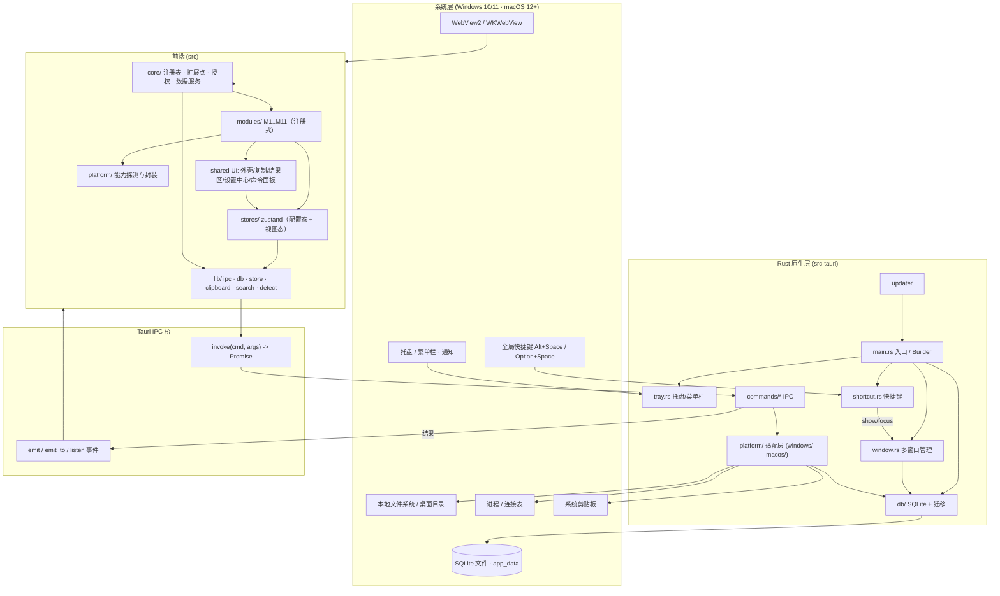

# Handy · 顺手 — 系统架构设计

| 项目 | 内容 |
| --- | --- |
| 文档类型 | 系统架构设计（ARCHITECTURE）· **增量升级版** |
| 产品名 / 项目代号 | **Handy · 顺手** / `handy`（已定，见 PRD §2） |
| 文档版本 | **v2.0** |
| 目标平台 | **Windows 10 1809+ / Windows 11（x64、arm64）+ macOS 12+（Apple Silicon / Intel）**，Linux Phase 3+ |
| 技术栈（已定） | Tauri 2（Rust）+ React 18 + TypeScript + Vite + Tailwind + shadcn/ui |
| 上游文档 | `docs/01-planning/PRD.md`（权威）、`docs/99-archive/ARCHITECTURE-v1.md`（v1，本文在其上做增量） |
| 语言 | 简体中文 |

> **增量原则**：v1 的技术底座（Tauri 2 / React18+TS+Vite / Tailwind+shadcn / 工具注册表 / IPC 契约 / Rust release 优化 profile）**整体沿用，不推翻**。本文件只记录 **v2 相对 v1 的增量决策（ADR-5…ADR-10）、结构扩展与新增契约**；与 v1 一致的部分以「**沿用**」标注，不重复展开。v1 文件保留不动。

---

## 0. v2 增量速览（一页）

| 维度 | v1 | v2 增量 | 对应 ADR |
| --- | --- | --- | --- |
| 平台 | 仅 Windows | **Win + macOS 同一代码基座**，平台差异下沉到适配层 | ADR-5 |
| 组织单元 | 工具注册表（Tool） | **模块（Module）+ 功能（Command）双层注册**，扩展点统一 | ADR-6 |
| 持久化 | `tauri-plugin-store`（JSON） | **SQLite（`tauri-plugin-sql`）为主数据层**；store 仅存应用级配置 | ADR-7 |
| 窗口模型 | 单主窗口 + 隐藏预创建 | **多窗口管理**（便签多实例 / 设置 / 快捷面板 / 桌面整理） | ADR-8 |
| 交付 | 绿色运行 | **MSI/NSIS + DMG 一键安装**，签名、公证、自动更新、CI 矩阵 | ADR-9 |
| 商业 | 无 | **L1/L2/L3 扩展点 + Pro 功能分级 / License 校验接口**（本期仅接口） | ADR-10 |

---

## 1. 增量决策记录（ADR v2）

### ADR-5：跨平台策略 —— Tauri 2 双端架构 + 平台适配层

**结论：采用 Tauri 2 单一代码基座同时交付 Windows 与 macOS；所有平台差异收敛到 `src/platform/`（前端）与 `src-tauri/src/platform/`（Rust）两层适配，业务代码只依赖抽象接口，不出现 `if windows` 散落。**

| 维度 | Windows | macOS | 架构处理 |
| --- | --- | --- | --- |
| WebView 内核 | WebView2（Edge，Win10 1809+ 多已内置） | WKWebView（系统自带） | Tauri 自动选择，无需业务关注 |
| 托盘形态 | 系统托盘（`TrayIcon`） | 菜单栏图标（`TrayIcon`，形态同、交互随平台习惯） | 同一 `tray.rs`，文案/图标按 `cfg` 区分 |
| 全局快捷键 | 默认 `Alt+Space` | 默认 `Option+Space`（**避开 `Cmd+Space`/Spotlight**） | Rust `shortcut.rs` 按平台取默认值 |
| 剪贴板监听 | 直接轮询剪贴板 | 需剪贴板/辅助功能授权，首次引导 | 平台能力探测 + 授权引导 |
| 桌面整理 | 可枚举/操作桌面图标 | 图标由系统管控，**降级为「文件归类」** | 能力开关 + 降级说明（见 §5.3） |
| 系统信息 | Win32 API | `sysctl`/IOKit | `platform/{windows,macos}` 分实现 |
| 提权 | UAC runas | `AuthorizationServices` / 引导用户 | 统一 `NEED_ELEVATION` 错误契约 |
| 通知 | Toast（WinRT） | `UNUserNotificationCenter` | `tauri-plugin-notification` 统一 API |
| 打包 | `.msi` + `.exe`(NSIS) | `.dmg`（含 `.app`） | `tauri.conf.json` 设 `bundle.targets = "all"`（= 当前宿主平台支持的全部目标；**Tauri 2 不支持按平台的对象写法**） |

**Rust 侧平台适配层设计（trait + `cfg` 分实现）：**

```rust
// src-tauri/src/platform/mod.rs
#[cfg(target_os = "windows")]
mod windows;
#[cfg(target_os = "macos")]
mod macos;

pub trait PlatformOps: Send + Sync {
    fn os_name(&self) -> &'static str;
    fn arch(&self) -> &'static str;
    /// 平台能力清单（供前端做降级展示 / 授权引导）
    fn capabilities(&self) -> PlatformCapabilities;
    /// 系统信息（CPU/内存/磁盘/版本）
    fn system_info(&self) -> Result<SystemInfo, String>;
    /// 桌面条目枚举（用于 M2：Win 可含图标，mac 仅文件）
    fn enumerate_desktop(&self) -> Result<Vec<DesktopEntry>, String>;
    /// 移动桌面条目到目标目录（用于 M2 归类）
    fn move_desktop_entries(&self, moves: &[MoveOp]) -> Result<(), String>;
    /// 剪贴板读取（mac 需授权，未授权返回 PermissionDenied）
    fn read_clipboard(&self) -> Result<ClipPayload, String>;
}

#[cfg(target_os = "windows")]
pub fn current() -> impl PlatformOps { windows::WindowsOps }

#[cfg(target_os = "macos")]
pub fn current() -> impl PlatformOps { macos::MacOsOps }
```

**前端平台抽象（`src/platform/`）：**

```ts
// src/platform/index.ts
export type Platform = 'windows' | 'macos' | 'linux' | 'unknown';
export interface PlatformCapabilities {
  clipboardWatch: boolean;        // 是否可后台监听剪贴板（已授权）
  desktopIcons: boolean;          // 是否可操作桌面「图标」（mac=false）
  desktopFileOrganize: boolean;   // 是否可做文件归类
  screenRecording: boolean;       // 屏幕录制权限（M6 用）
  systemInfo: boolean;
  tray: 'tray' | 'menubar';
}
export const platform: Platform;           // 由 platform_info 命令注入
export const capabilities: PlatformCapabilities;
export function hotkeyDefault(): string;   // Win: Alt+Space / mac: Option+Space
```

**边界纪律**：业务组件与模块**只调用 `ipc.*` 与 `platform.*`**，禁止在业务代码里直接写 `navigator.userAgent` 判断或 `import.meta.env` 平台分支（`import.meta.env` 仅用于是否 dev 构建等构建期信息）。

> 复用 v1：ADR-1（Tauri 2 而非 Electron）、ADR-4（Rust/前端职责边界）、§7 插件清单（快捷键/托盘/单实例/自启/更新）**全部沿用**。

---

### ADR-6：模块化架构 —— 模块（Module）与功能（Command）双层注册 + 统一扩展点

**结论：v1 的「工具注册表」升级为「模块 + 功能」双层注册体系。**
- **模块（Module）** = 一个顶层功能域（M1…M11），拥有独立 UI 承载形态（面板内页 / 独立窗口 / 浮层）、可选独立数据表、生命周期钩子与扩展点贡献。
- **功能（Command）** = 挂靠在模块下的轻量能力（v1 的「工具」即 M1 模块下的 Command）。命令面板搜索、收藏、最近、历史、一键复制外壳**自动生效**。

**「零框架改动」的达成手段：自动发现（`import.meta.glob`）+ 契约式注册。**

```
新增「工具型功能」（如 M1 再加一个「UUID 生成」）：
  1) 新建 src/modules/toolbox/commands/UuidGenerator.tsx（默认导出 CommandProps 组件）
  2) 在 src/modules/toolbox/commands/index.ts 追加一条 CommandMeta
  → 完成。命令面板/收藏/最近/历史/复制外壳自动生效，框架零改动。

新增「模块」（如 Phase 2 的 M6 截图）：
  1) 新建 src/modules/screenshot/index.ts（导出 ModuleMeta：含视图组件、commands、windowSpec）
  2) 若需独立窗口/新系统能力：在 src-tauri/src/window.rs 注册一个新 WindowKind；在 src/platform 暴露新能力
  → 完成。入口/设置分区/托盘项/搜索由注册表自动聚合，框架零改动。
```

**注册发现机制**（不维护手工大数组，避免「集中注册表冲突」）：

```ts
// src/core/moduleRegistry.ts（节选）
const moduleModules = import.meta.glob<{ default: ModuleMeta }>('../modules/*/index.ts', { eager: true });
// 每个模块内部再 glob 自己的 commands
```

**Extension Points（扩展点）—— 为 L2/L3 预留：**

```ts
export type ExtensionPointId =
  | 'command'                // 命令/工具（M1 及各模块）
  | 'settings.section'       // 设置中心分区
  | 'tray.item'              // 托盘/菜单栏项
  | 'clipboard.transform'    // 剪贴板内容动作（转便签/转待办/格式化…）
  | 'detect.matcher'         // 剪贴板内容识别器（JSON/JWT/时间戳/URL…）
  | 'palette.provider'       // 命令面板结果提供者（工具/最近/收藏，未来接入应用/文件）
  | 'module.activation';     // 模块激活
```

任何模块通过 `contributes` 声明贡献，注册表 `collect(point)` 聚合。**L2 官方扩展包 = 一个能被动态加载、向同名扩展点 contribute 的打包产物**；本期仅设计接口与加载边界，不实现下载/校验（见 ADR-10）。

**v1 → v2 映射**：v1 `ToolMeta`/`ToolRegistry`/`ToolProps` → v2 `CommandMeta`/`ModuleRegistry.findCommand`/`CommandProps`，字段语义保持兼容（`id/name/alias/keywords/layout/sensitive/load` 等**沿用**）。

---

### ADR-7：持久化选型修订（**重点**）—— 结论：**SQLite 为主数据层，store(JSON) 仅存应用级配置**

**结论（明确判断）：MVP 起即引入 `tauri-plugin-sql`（SQLite）作为主数据层，承载便签、待办、剪贴板历史、使用历史、桌面整理撤销记录等所有「实体数据 / 高频写入 / 需检索」的数据；`tauri-plugin-store`(JSON) 降级为「应用级配置」专用（settings / 模块开关 / Pro 标记 / License 缓存，体积 < 10KB、无关联、需 Rust 早期读取）。**

**为什么必须从 store 切到 SQLite（相对 v1 的判断）**：

| 场景 | `store`(JSON) 的问题 | SQLite 的优势 |
| --- | --- | --- |
| 剪贴板历史（每次复制都写） | 每次写入**重写整个 JSON 文件**，O(n) 且崩溃易损坏；无去重/裁剪的原子性 | 单行 INSERT + 唯一约束去重 + 单条 DELETE 裁剪，**事务原子** |
| 便签（拖动位置高频更新） | 改一个便签坐标要序列化全部便签 | `UPDATE notes SET x,y WHERE id=?` **局部更新** |
| 搜索 | 只能全量载入内存后遍历 | 索引 + **FTS5 全文检索**（剪贴板/便签搜索） |
| 数据量增长（M3/M4 是留存核心） | 条数上升后读写放大、启动变慢 | 索引支撑万级数据仍稳定 |
| 多模块共享 | 单 JSON 易冲突、耦合 | 分表，模块间用外键/查询 |
| 崩溃一致性 | 半写文件损坏风险 | WAL 日志保证 |

**保留 store 的理由**：settings 需要 **Rust 在前端未加载时读取**（开机即注册快捷键/主题），是非关系型小配置；继续用 store 可让 Rust 侧零迁移地早读，且避免「UI 未起就已开库」。**职责清晰：配置进 store，数据进 SQLite。**

**SQLite 表设计（主数据层，`src-tauri/src/db/`）**：

| 表 | 关键字段 | 用途 |
| --- | --- | --- |
| `notes` | `id PK, title, body, color, pinned, x, y, w, h, opacity, z, created_at, updated_at` | 便签（含窗口几何） |
| `todos` | `id PK, title, done, priority, due_at, remind_at, reminded, note_id FK?, created_at, updated_at` | 待办 |
| `clip_items` | `id PK, kind, content, thumb, source_app, pinned, sensitive, created_at` | 剪贴板历史（默认保留最近 100，可配置） |
| `clip_fts` | FTS5(`content`) | 剪贴板/笔记全文检索 |
| `usage_history` | `id PK, tool_id, input, output, pinned, created_at` | 工具使用历史（沿用 v1 语义，迁到 SQLite） |
| `organize_plans` | `id PK, payload JSON, applied, created_at` | 桌面整理计划 / 撤销记录 |
| `module_state` | `module_id PK, enabled, updated_at` | 模块启停 |
| `schema_migrations` | `version PK, applied_at` | 版本迁移 |

**迁移路径（v1 store → v2）**：

```
首次启动 v2：
  1) 检测 store 中 v1 键：favorites / recentTools / history / clipboardHistory / settings
  2) settings          → 保留在 store（不迁移）
  3) clipboardHistory  → 批量导入 clip_items（kind 推断沿用 detect.ts；sensitive 跳过）
  4) history           → 批量导入 usage_history
  5) favorites/recent  → 保留在 store（仍属配置态）
  6) 迁移完成后写入 schema_migrations.version=1，并删除已迁移的旧键（可回滚：迁移前备份 store 文件为 *.v1.bak）
DB 位置：app_config_dir()/handy.db（WAL 模式）；store 位置沿用 app_config_dir()/settings.json

> **勘误（V04 QA 核实）**：Tauri 2 下 `tauri-plugin-sql` 的连接串 `sqlite:handy.db` 由插件解析到
> `app_config_dir()`（**非** v1 的 `app_data_dir()`）。Rust 侧 `src-tauri/src/db/mod.rs` 的 `init()`
> 亦使用 `app_config_dir()`，二者路径一致——不存在「同一逻辑库落在两个文件」的隐患。
> 若将其误写为 `app_data_dir()`，前端插件与 Rust 迁移会各建一个 `handy.db`。
```

**演进策略**：新增模块若要独立数据集，**加一张表 + 一个 migration 文件**，不改其他表；接口统一走 `src/lib/db.ts`（前端）/ `src-tauri/src/db/`（Rust），业务不直接拼 SQL。

---

### ADR-8：多窗口架构 —— 窗口类型模型 + 状态隔离 + 跨窗事件

**结论：引入窗口管理器（Rust `WindowManager`），定义窗口类型（WindowKind），每种窗口由 `label` 唯一标识；不同 WebView = 独立 JS 运行环境（状态天然隔离），跨窗同步走「SQLite 为唯一事实源 + Tauri 事件广播」。**

| WindowKind | label | 形态 | 数量 | 说明 |
| --- | --- | --- | --- | --- |
| `Main` | `main` | 无边框浮层窗口（命令面板 / 面板内路由） | 1 | 启动即预创建隐藏，快捷键 `show()+set_focus()`，首帧 <300ms |
| `Settings` | `settings` | 常规窗口 | 1 | 设置中心 |
| `Note` | `note-{id}` | **无边框 + 置顶可选 + 可透明 + 不同任务栏 + 独立几何** | N | 便签多实例；关闭窗口≠删除数据 |
| `ClipboardQuick` | `clip-quick` | 浮层小窗（快捷历史） | 1 | 可选 |
| `DesktopOrganizer` | `organizer` | 常规窗口 | 1 | 桌面整理预览/确认（M2） |
| `ScreenshotOverlay` | `shot-overlay` | 全屏透明覆盖窗 | 1 | **Phase 2**，本期占位不实现 |

**Rust 窗口管理器（新增 `src-tauri/src/window.rs` 的扩展）：**

```rust
pub enum WindowKind { Main, Settings, Note(String), ClipboardQuick, DesktopOrganizer }

impl WindowManager {
    pub fn ensure_main(&self, app: &AppHandle) -> Result<()>;      // 预创建隐藏
    pub fn open(&self, app: &AppHandle, kind: WindowKind) -> Result<WebviewWindow>;
    pub fn open_note(&self, app: &AppHandle, note_id: &str) -> Result<WebviewWindow>;
    pub fn close_kind(&self, app: &AppHandle, kind: WindowKind);
    pub fn restore_notes(&self, app: &AppHandle) -> Result<usize>; // 启动时按 notes 表恢复窗口
}
```

**状态隔离与同步**：

- 每个便签窗口加载 `index.html?window=note&noteId=xxx`，`src/main.tsx` 依 `window` 参数挂载不同的根（`NoteApp` / `SettingsApp` / `MainApp`），**各窗 zustand 相互独立**。
- 数据变更**先写 SQLite**，再 `emit('note:updated', {id})`（广播）；其他窗口 `listen` 后**按 id 重查**（不传全量、防不一致）。
- 便签几何（x/y/w/h/z/opacity）持久化在 `notes` 表，**关闭重开位置不丢**。
- 主窗口与托盘对便签的「显隐/全部隐藏」通过事件驱动，不直接操作对方 DOM。

**风险提示**：多窗口内存随窗口数增长（见 §10 风险 R-V3），便签窗口采用轻量根（只挂便签视图，不挂全量 UI 与全模块注册）。

---

### ADR-9：打包与分发 —— MSI/NSIS + DMG、WebView2 策略、签名/公证、自动更新、CI 矩阵

**结论：`tauri.conf.json` 按平台配置 `bundle`，Win 出 `.msi`(WiX)+`.exe`(NSIS)，mac 出 `.dmg`；Win 采用 WebView2 **downloadBootstrapper**（保体积达标）＋「缺失检测+引导」；mac 走 **Developer ID 签名 + 公证 + staple**；更新走 `tauri-plugin-updater`（签名校验）；CI 用 GitHub Actions 三 runner 矩阵。**

| 项 | Windows | macOS |
| --- | --- | --- |
| 产物 | `.msi`（WiX，企业静默安装）+ `.exe`（NSIS，面向普通用户） | `.dmg`（可拖入 Applications）；架构 通用二进制（arm64 + x86_64） |
| WebView2 | `webviewInstallMode: downloadBootstrapper`（体积优先；Win10 1809+ 多已随 Edge 内置）+ 启动缺失检测引导 | 系统自带 WKWebView，无需处理 |
| 签名 | Authenticode（EV/OV 证书，`signtool`） | Developer ID Application 证书（`codesign --deep --options runtime`） |
| 公证 | 无需 | `notarytool submit` + `stapler staple`（合规硬要求，PRD §8.2） |
| 权限声明 | 无 | `Info.plist` 用途说明（剪贴板/辅助功能/屏幕录制）+ Privacy Manifest |
| 自动更新 | `updater` 端点 + 公钥校验，产物带 `.sig` | 同左 |
| 安装包目标 | **< 30MB** | **< 40MB** |

**CI 构建矩阵（`.github/workflows/release.yml` 要点）：**

```
jobs.build:
  matrix.os: [windows-latest, macos-14 (arm64), macos-13 (x86_64)]
  steps:
    - 安装 Rust（rust-toolchain.toml 锁定）+ Node LTS
    - 前端: npm ci && npm run build
    - 构建: tauri build --target <triple>
    - Win: signtool 签名 → 产物 .msi/.exe
    - mac: codesign → notarytool submit --wait → stapler → 产物 .dmg
    - 上传 artifacts + 生成/校验 updater 清单（latest.json）
```
（MVP 也可先出「本地构建脚本 + 手动发版」，CI 作为 Phase 1 收尾增强，见 TASKS V14。）

---

### ADR-10：扩展与授权预留 —— L1/L2/L3 扩展点、Pro 分级与 License 校验接口（本期仅接口）

**结论：本期只实现 L1（内置模块）与「扩展点契约 + 授权接口」，**不实现** L2 下载、L3 第三方插件。**

| 层级 | 本期 | 架构落点 |
| --- | --- | --- |
| **L1 内置模块** | ✅ 实现 | 随包发布，走 `import.meta.glob` 注册（ADR-6） |
| **L2 官方扩展包** | 🔲 仅接口 | 定义 `ExtensionPackage` 清单 + `ExtensionLoader` 抽象（`load/id/verify`），本期用「假实现/本地目录」占位，**不联网下载** |
| **L3 第三方插件** | ❌ 不做 | 预留签名/沙箱/权限清单字段，Phase 4 评估 |

**功能分级与授权（License）接口：**

```ts
// src/core/license.ts
export type Tier = 'free' | 'pro';

export interface FeatureGate { featureId: string; minTier: Tier; }

export interface LicenseProvider {
  getTier(): Promise<Tier>;                 // 本期恒返回 'free'（读 store 缓存）
  isUnlocked(featureId: string): Promise<boolean>;
  activate(key: string): Promise<ActivationResult>; // 本期返回 { ok:false, reason:'not_implemented' }
  listGates(): FeatureGate[];
}

export const license: LicenseProvider;      // 单例，模块/命令通过 meta.tier 参与判定
```

- `ModuleMeta.tier` / `CommandMeta.tier` 声明免费/Pro；UI 对 Pro 且未解锁项显示「升级」占位（**不弹诱导付费，PRD §7.3**）。
- 授权状态缓存进 store（`license.cache`），Rust 侧不接支付、不联网校验（本期）。
- **L2 扩展点**由 ADR-6 的 `ExtensionPointId` 统一承载；L2 包即「一组向扩展点 contribute 的打包资源」。

---

## 2. 整体架构图（v2）



---

## 3. 目录结构 v2（完整树）

> 沿用 v1「扁平、少层级」偏好。新增 `src/modules/`（按模块分）、`src/core/`（注册表/扩展点/授权/数据服务）、`src/platform/`；Rust 新增 `src-tauri/src/platform/{windows,macos}` 与 `db/`。

```
handy/
├── docs/
│   ├── README.md
│   ├── 01-planning/{PRD.md, TOOLS_INVENTORY.md, DECISIONS.md}
│   ├── 02-architecture/{ARCHITECTURE.md, TASKS.md,
│   │                    class-diagram.mermaid, sequence-diagram.mermaid}
│   ├── 03-development/DEVELOPMENT.md
│   └── 99-archive/{PRD-v1.md, ARCHITECTURE-v1.md, TASKS-v1.md, DECISIONS-v1.md}
├── package.json  vite.config.ts  tsconfig.json  tsconfig.node.json
├── tailwind.config.ts  postcss.config.js  index.html  .gitignore  README.md
├── rust-toolchain.toml                      # 锁定 Rust 版本（CI 复用）
├── .github/workflows/{ci.yml, release.yml}  # 双平台构建矩阵
├── src/                                     # ===== 前端 =====
│   ├── main.tsx                             # 依 ?window= 分派：MainApp / NoteApp / SettingsApp
│   ├── App.tsx                              # 主窗口路由（面板 / 模块内页）
│   ├── index.css                            # Tailwind 指令 + 设计令牌
│   ├── core/                                # ★ v2 新增：框架内核
│   │   ├── types.ts                         # ModuleMeta / CommandMeta / ModuleProps / CommandProps
│   │   ├── moduleRegistry.ts                # 模块+功能注册、搜索、启停、扩展点 collect
│   │   ├── extensionPoints.ts               # 扩展点定义与契约（L2/L3 预留）
│   │   ├── license.ts                       # 授权/分级接口（本期仅接口）
│   │   ├── data/                            # 跨模块共享数据服务
│   │   │   ├── notesService.ts              # 便签 CRUD（封装 db.ts）
│   │   │   ├── todosService.ts              # 待办 CRUD
│   │   │   ├── clipboardService.ts          # 剪贴板历史读写/搜索/裁剪
│   │   │   └── bus.ts                       # 跨模块事件总线（emit/listen 包装）
│   │   └── bootstrap.ts                     # 启动装配：注册模块、恢复窗口、权限探测
│   ├── modules/                             # ★ v2 新增：各功能模块（自注册）
│   │   ├── toolbox/                         # M1 效率工具箱
│   │   │   ├── index.ts                     # ModuleMeta
│   │   │   ├── ToolboxView.tsx
│   │   │   └── commands/                    # 8 个子工具（MVP）
│   │   │       ├── index.ts                 # CommandMeta 数组（自动被发现）
│   │   │       ├── TimestampConverter.tsx
│   │   │       ├── JsonFormatter.tsx
│   │   │       ├── Base64Codec.tsx
│   │   │       ├── PasswordGenerator.tsx
│   │   │       ├── TextDiff.tsx
│   │   │       ├── UrlCodec.tsx
│   │   │       ├── HashGenerator.tsx
│   │   │       └── QrCodeGenerator.tsx
│   │   ├── notes/                           # M3 便签·待办·提醒
│   │   │   ├── index.ts                     # ModuleMeta（含 windowSpec: note）
│   │   │   ├── NoteWindow.tsx               # 便签独立窗根视图
│   │   │   ├── TodoView.tsx                 # 待办清单
│   │   │   ├── ReminderScheduler.tsx        # 提醒调度（前端）
│   │   │   └── commands/index.ts            # 「新建便签 / 新建待办 / 便签转待办」
│   │   ├── clipboard/                       # M4 剪贴板增强
│   │   │   ├── index.ts
│   │   │   ├── ClipboardHistory.tsx
│   │   │   ├── matchers.ts                  # detect.matcher 贡献（JSON/JWT/URL/时间戳）
│   │   │   └── commands/index.ts            # 「打开剪贴板历史 / 回贴」
│   │   └── desktop-organizer/               # M2 桌面整理（基础版）
│   │       ├── index.ts
│   │       ├── OrganizerView.tsx            # 扫描→预览→应用→撤销
│   │       └── commands/index.ts            # 「整理桌面」
│   ├── components/                          # 共享 UI（非模块专属）
│   │   ├── ui/                              # shadcn 原子组件（沿用 v1）
│   │   ├── CommandPalette.tsx               # 命令面板（统一入口，沿用+增强）
│   │   ├── SearchSuggest.tsx                # 剪贴板智能建议条
│   │   ├── CommandShell.tsx                 # 工具/功能外壳（原 ToolShell）
│   │   ├── CopyButton.tsx  ResultBox.tsx    # 沿用 v1
│   │   ├── SettingsCenter.tsx               # 设置中心（聚合各模块 settings.section）
│   │   ├── ModuleSidebar.tsx                # 模块侧栏（面板内导航）
│   │   └── AppLayout.tsx
│   ├── lib/
│   │   ├── ipc.ts                           # 类型化 invoke 封装（沿用+扩展）
│   │   ├── db.ts                            # ★ SQLite 前端封装（tauri-plugin-sql）
│   │   ├── store.ts                         # 配置态持久化（tauri-plugin-store）
│   │   ├── clipboard.ts  search.ts  detect.ts  utils.ts   # 沿用 v1
│   ├── stores/
│   │   ├── useAppStore.ts                   # 全局（主题/模块开关/首次运行）
│   │   ├── useFavoritesStore.ts  useRecentStore.ts   # 沿用（配置态）
│   │   └── useClipboardStore.ts  useNotesStore.ts
│   ├── platform/                            # ★ v2 新增：平台抽象
│   │   ├── index.ts                         # platform/capabilities/hotkeyDefault
│   │   └── detect.ts                        # 从 platform_info 命令注入
│   ├── hooks/{useHotkeyOpen.ts, useClipboardWatch.ts, useToolExecution.ts}
│   └── assets/
└── src-tauri/                              # ===== Rust =====
    ├── Cargo.toml  build.rs  tauri.conf.json  rust-toolchain.toml
    ├── capabilities/{default.json, desktop.json}   # 最小权限清单
    ├── icons/
    └── src/
        ├── main.rs                          # Builder、插件、命令注册
        ├── window.rs                        # ★ 多窗口管理
        ├── tray.rs  shortcut.rs             # 沿用 v1（增加平台差异）
        ├── platform/                        # ★ v2 新增：平台适配层
        │   ├── mod.rs                       # PlatformOps trait + 能力枚举
        │   ├── windows.rs                   # Win32 实现
        │   └── macos.rs                     # macOS 实现（含降级）
        ├── db/                              # ★ v2 新增：SQLite
        │   ├── mod.rs                       # 连接池 / 初始化 / WAL
        │   ├── migrations.rs                # 版本迁移
        │   └── schema.sql                   # 建表 DDL（notes/todos/clip_items/…）
        └── commands/
            ├── mod.rs
            ├── net.rs  file.rs  system.rs  clipboard.rs   # 沿用 v1
            ├── notes.rs  todos.rs           # ★ 便签 / 待办 CRUD
            ├── clip.rs                      # ★ 剪贴板历史读写
            ├── organizer.rs                 # ★ 桌面整理 plan/apply/undo
            └── app.rs                       # ★ 模块启停 / 窗口 / 备份 / 平台信息
```

| 目录 | 职责 | 关键约定 |
| --- | --- | --- |
| `src/core/` | 内核：注册表、扩展点、授权、跨模块数据服务 | 不依赖任何具体模块 |
| `src/modules/<id>/` | 一个模块一个目录，`index.ts` 导出 `ModuleMeta` 自注册 | 模块间只经 `core/data/*` 或事件总线通信 |
| `src/platform/` | 平台能力探测与封装 | 业务不写平台分支 |
| `src-tauri/src/platform/` | `PlatformOps` trait + per-OS 实现 | 用 `#[cfg]` 条件编译，不用运行时字符串判断 |
| `src-tauri/src/db/` | SQLite 连接、迁移、schema | 业务不直接拼 SQL |

---

## 4. 模块与功能注册契约（核心）

### 4.1 TypeScript 接口

```ts
// src/core/types.ts
import type { ComponentType } from 'react';

export type Platform = 'windows' | 'macos' | 'linux' | 'unknown';
export type Tier = 'free' | 'pro';
export type ModuleSurface = 'panel' | 'window' | 'overlay' | 'tray';
export type CommandLayout = 'split' | 'tab' | 'form' | 'preview' | 'full';
export type WindowKind = 'main' | 'settings' | 'note' | 'clip-quick' | 'organizer';

/** 模块：顶层功能域 */
export interface ModuleMeta {
  id: string;                       // 'notes'
  name: string;                     // '便签·待办'
  description: string;
  icon: string;                     // lucide 图标名
  color?: string;                   // 主题色（侧栏/标签）
  order: number;                    // 展示排序
  surface: ModuleSurface[];         // 支持的承载形态
  tier: Tier;                       // 免费/Pro（授权预留）
  keywords: string[];
  platforms?: Platform[];           // 限定平台（缺省=全平台）
  capabilities?: string[];          // 依赖的系统能力（用于权限引导/降级）
  route?: string;                   // 面板内路由（panel surface）
  windowSpec?: { kind: WindowKind; multi?: boolean; frameless?: boolean; alwaysOnTop?: boolean };
  /** 生命周期（激活=注册命令/启动监听；停用=释放） */
  activate?: () => Promise<void>;
  deactivate?: () => Promise<void>;
  /** 扩展点贡献（自动聚合，无需改框架） */
  contributes?: {
    commands?: CommandMeta[];
    settingsSection?: SettingsSection;
    trayItems?: TrayItem[];
    clipboardTransforms?: ClipboardTransform[];
    detectors?: Detector[];
  };
  /** 面板内页的懒加载视图 */
  loadView?: () => Promise<{ default: ComponentType<ModuleProps> }>;
}

/** 功能（命令/工具）：轻量、可被面板搜到的能力 */
export interface CommandMeta {
  id: string;                       // 'timestamp'
  moduleId: string;                 // 归属模块 'toolbox'
  name: string;                     // '时间戳转换'
  description: string;
  icon?: string;
  aliases: string[];                // ['ts','timestamp','sjc']
  keywords: string[];               // 含拼音首字母
  layout?: CommandLayout;
  tier: Tier;
  sensitive?: boolean;              // 结果默认不写历史/剪贴板（密码/密钥）
  isOnline?: boolean;               // MVP 全 false
  platforms?: Platform[];
  load: () => Promise<{ default: ComponentType<CommandProps> }>;
}

/** 独立窗口/面板内页的模块视图入参 */
export interface ModuleProps {
  windowKind?: WindowKind;
  context?: Record<string, string>; // 如 { noteId: 'xxx' }
}

/** 命令组件入参（沿用 v1 ToolProps 语义，新增跨模块跳转） */
export interface CommandProps {
  initialInput?: string;
  source?: 'clipboard' | 'history' | 'command' | 'manual';
  onUsed?: (id: string) => void;
  onRequestModule?: (moduleId: string, payload?: unknown) => void; // 便签↔剪贴板互转
}

/** 扩展点贡献类型 */
export interface SettingsSection { id: string; title: string; order: number; render: () => JSX.Element; }
export interface TrayItem { id: string; label: string; onClick: () => void; }
export interface ClipboardTransform { id: string; label: string; run: (content: string) => void; }
export interface Detector { id: string; match(text: string): { kind: string; suggestion: string } | null; }
```

### 4.2 `ModuleRegistry` API

```ts
// src/core/moduleRegistry.ts
export interface ModuleRegistry {
  // 模块
  register(mod: ModuleMeta): void;
  get(id: string): ModuleMeta | undefined;
  list(opts?: { includeDisabled?: boolean; tier?: Tier }): ModuleMeta[];
  enabled(): ModuleMeta[];
  setEnabled(id: string, on: boolean): Promise<void>;

  // 功能（命令）
  registerCommands(moduleId: string, cmds: CommandMeta[]): void;
  commands(): CommandMeta[];
  findCommand(id: string): CommandMeta | undefined;
  searchCommands(query: string, opts?: { limit?: number }): CommandMeta[];

  // 扩展点
  contribute<T>(point: ExtensionPointId, item: T): void;
  collect<T>(point: ExtensionPointId): T[];
}
export const registry: ModuleRegistry;
```

### 4.3 「新增」分别要改哪些文件（具体）

| 目标 | 必须新增/修改的文件 | 框架是否改动 |
| --- | --- | --- |
| **新增一个「工具型功能」**（如 M1 再加 UUID 生成） | ① 新增 `src/modules/toolbox/commands/UuidGenerator.tsx`；② 在 `src/modules/toolbox/commands/index.ts` 追加一条 `CommandMeta` | **否**（`import.meta.glob` 自动发现） |
| **新增一个模块**（如 Phase 2 的 M6 截图） | ① 新建 `src/modules/screenshot/{index.ts, ScreenshotView.tsx, commands/index.ts}`；② 若需独立窗口：`src-tauri/src/window.rs` 加一个 `WindowKind` 分支；③ 若需新系统能力：`src-tauri/src/commands/` 加命令 + `src/platform` 加能力字段 | **否**（注册/入口/设置分区/托盘自动聚合） |
| **新增一张数据表** | ① `src-tauri/src/db/migrations.rs` 加一个 migration；② `src/core/data/<x>Service.ts` 加服务 | **否** |

### 4.4 模块间数据共享（便签 ↔ 剪贴板互转）

- 共享数据统一放 `src/core/data/*Service.ts`，**以 SQLite 为唯一事实源**。
- 剪贴板「转便签」：`clipboardService` 项 → 调用 `notesService.createNote({ body, source: 'clipboard' })` → `bus.emit('note:created', { id })` → `windowManager.open_note(id)`（IPC `window_open_note`）。
- 便签「复制到剪贴板」：`write_clipboard` + `clipboardService.add({ source_app:'note' })`。
- 反向亦同。**模块之间不直接 import 对方组件**，只依赖 `core/data` 服务与事件总线。

---

## 5. 多窗口与系统能力设计

### 5.1 便签窗口

| 特性 | 设计 |
| --- | --- |
| 形态 | `decorations:false`，自绘标题栏；`alwaysOnTop` 每便签可配；`transparent` 支持；`skipTaskbar:true` |
| 多实例 | label=`note-{id}`，一便签一窗口；关闭窗口仅隐藏，不删数据 |
| 几何持久化 | 写入 `notes` 表（x/y/w/h/z/opacity），重开恢复 |
| 交互 | 全部走 IPC 命令（`note_update`/`note_set_position`），写库后 `emit('note:updated')` |
| 轻量根 | NoteApp 只挂载便签视图，不加载全模块注册表（降内存） |

### 5.2 截图覆盖窗（Phase 2，本期占位）

`shot-overlay` 全屏透明窗 + 屏幕录制权限授权引导；本期仅保留 `WindowKind` 枚举占位与 `screenRecording` 能力字段，不实现。

### 5.3 托盘 / 菜单栏与桌面整理差异

| 能力 | Windows | macOS | 降级/替代 |
| --- | --- | --- | --- |
| 常驻图标 | 系统托盘 | 菜单栏图标 | 同 `tray.rs`，图标/文案按平台 |
| 托盘菜单 | 打开 / 新建便签 / 整理桌面 / 设置 / 退出 | 同（菜单栏习惯） | 一致 |
| 左键行为 | toggle 主窗 | 展开菜单（mac 习惯） | 按平台 |
| 桌面条目枚举 | 直接枚举桌面目录（含图标位置可用 Shell API 扩展） | 受系统管控，**仅枚举文件** | mac 仅「文件归类」 |
| 桌面图标收纳盒 | 可做（Phase 2+） | **不做** | 明确降级 |
| 归类/预览/撤销 | 支持 | 支持 | 一致（撤销靠 `organize_plans`） |
| 权限 | 无需额外 | 首次需「桌面/完全磁盘访问」授权 | 授权引导；拒绝则功能置灰 |

**M2 桌面整理实现路径**：`desktop_scan`（枚举）→ 前端规则引擎生成 `plan`（按类型/日期）→ `desktop_plan_organize` 返回预览 → 用户确认 → `desktop_apply_plan`（Rust 执行移动，记录到 `organize_plans`）→ 可 `desktop_undo_plan`。

---

## 6. IPC 命令契约 v2

> 沿用 v1 约定：命令名 `snake_case`，返回 `Result<T, String>`（中文可读错误）。下表**加粗为新增加命令**，并标注平台差异。

### 6.1 沿用 v1（Win/mac 双实现，标注差异）

| 命令 | 用途 | 平台差异 |
| --- | --- | --- |
| `read_clipboard` / `write_clipboard` | 剪贴板文本读写 | mac 首次需授权 |
| `update_hotkey` | 快捷键注册/冲突检测 | 默认键不同（Alt+Space / Option+Space） |
| `set_autostart` | 开机自启 | Win 注册表 / mac LaunchAgents |
| `get_local_ips` / `get_env_vars` | 网络/环境 | mac 部分变量语义不同 |
| `file_hash` / `read_file_text` / `detect_encoding` / `write_text_file` | 文件能力（Phase 2 复用于 M7） | 一致 |

### 6.2 新增命令 v2

| 命令 | 签名（Rust） | 用途 | 平台差异 |
| --- | --- | --- | --- |
| **`platform_info`** | `fn platform_info() -> Result<PlatformInfo, String>` | 返回 os/arch/能力清单，注入前端 `platform.ts` | 各平台不同 |
| **`window_open_note`** | `fn window_open_note(app, note_id: String) -> Result<(), String>` | 打开/聚焦便签窗 | — |
| **`window_close_note`** | `fn window_close_note(app, note_id: String) -> Result<(), String>` | 关闭便签窗（不删数据） | — |
| **`window_open`** | `fn window_open(app, kind: String) -> Result<(), String>` | 打开 settings/organizer 等 | — |
| **`note_list`** | `fn note_list() -> Result<Vec<Note>, String>` | 列出便签 | — |
| **`note_create`** | `fn note_create(input: NewNote) -> Result<Note, String>` | 新建便签 | — |
| **`note_update`** | `fn note_update(id: String, patch: NotePatch) -> Result<Note, String>` | 更新内容/颜色/置顶 | — |
| **`note_set_position`** | `fn note_set_position(id: String, geom: Geometry) -> Result<(), String>` | 保存窗口几何 | — |
| **`note_delete`** | `fn note_delete(id: String) -> Result<(), String>` | 删除便签 | — |
| **`todo_list` / `todo_create` / `todo_update` / `todo_toggle` / `todo_delete`** | `... -> Result<...>` | 待办 CRUD | — |
| **`todo_set_reminder`** | `fn todo_set_reminder(id: String, remind_at: i64) -> Result<(), String>` | 设置提醒 | 通知 API 不同 |
| **`notify`** | `fn notify(title: String, body: String) -> Result<(), String>` | 系统通知 | Win Toast / mac UNUserNotification |
| **`clip_list`** | `fn clip_list(limit: u32, query: Option<String>) -> Result<Vec<ClipItem>, String>` | 剪贴板历史（含搜索） | — |
| **`clip_add`** | `fn clip_add(item: NewClipItem) -> Result<ClipItem, String>` | 写入历史（去重 + 裁剪） | — |
| **`clip_pin` / `clip_delete` / `clip_clear`** | `...` | 置顶 / 删除 / 清空 | — |
| **`clip_watch_start` / `clip_watch_stop`** | `...` | 启动/停止剪贴板监听 | mac 需授权 |
| **`desktop_scan`** | `fn desktop_scan() -> Result<Vec<DesktopEntry>, String>` | 枚举桌面条目 | mac 仅文件，需授权 |
| **`desktop_plan_organize`** | `fn desktop_plan_organize(rule: OrganizeRule) -> Result<OrganizePlan, String>` | 生成整理计划（预览） | 规则同，条目来源不同 |
| **`desktop_apply_plan`** | `fn desktop_apply_plan(plan_id: String) -> Result<(), String>` | 执行整理 | — |
| **`desktop_undo_plan`** | `fn desktop_undo_plan(plan_id: String) -> Result<(), String>` | 撤销 | — |
| **`module_list_state` / `module_set_enabled`** | `...` | 模块启停 | — |
| **`license_get_tier` / `license_activate`** | `...` | 授权接口（本期 stub） | — |
| **`app_backup_export` / `app_backup_import`** | `... -> Result<String/.., String>` | 全量备份/导入（导出 db + store） | — |

---

## 7. 数据模型 v2

### 7.1 TS 接口

```ts
// 便签
export interface Note {
  id: string;
  title: string;
  body: string;
  color: string;                 // 便签配色
  pinned: boolean;               // 置顶（窗口层）
  x: number; y: number;          // 窗口几何
  w: number; h: number;
  opacity: number;               // 0-1
  z: number;                     // 层级
  createdAt: number; updatedAt: number;
}

// 待办
export interface Todo {
  id: string;
  title: string;
  done: boolean;
  priority: 0 | 1 | 2;           // 低/中/高
  dueAt?: number;                // 截止
  remindAt?: number;             // 提醒时间
  reminded: boolean;
  noteId?: string;               // 关联便签（便签↔待办互转）
  createdAt: number; updatedAt: number;
}

// 剪贴板项
export type ClipKind = 'text' | 'json' | 'jwt' | 'url' | 'timestamp' | 'base64' | 'image' | 'path';
export interface ClipItem {
  id: string;
  kind: ClipKind;
  content: string;               // 文本；image 存缩略/引用
  thumb?: string;                // 图片缩略（Phase 2）
  sourceApp?: string;            // 来源应用（尽力获取）
  pinned: boolean;
  sensitive: boolean;            // 敏感内容不落库
  createdAt: number;
}

// 桌面整理
export interface OrganizeRule { by: 'type' | 'date'; targets: string[]; }
export interface OrganizePlan { id: string; moves: { from: string; to: string; name: string }[]; createdAt: number; }

// 应用设置 v2（存 store）
export interface AppSettings {
  hotkey: string;                            // 平台默认见 platform.hotkeyDefault()
  theme: 'light' | 'dark' | 'system';
  autoLaunch: boolean;
  autoUpdate: boolean;
  closeToTray: boolean;
  clipboardWatch: boolean;                   // 剪贴板监听
  clipboardHistory: boolean;
  recordHistory: boolean;
  maxHistory: number;                        // 默认 50
  maxClipboard: number;                      // 默认 100
  sensitiveToolIds: string[];
  modules: Record<string, boolean>;          // 模块启停
  tier: 'free' | 'pro';                      // Pro 标记（授权预留）
  onboarded: boolean;                        // 首次引导完成
}
```

### 7.2 存储映射

| 数据 | 存储 | 键/表 | 说明 |
| --- | --- | --- | --- |
| AppSettings | store(JSON) | `settings.json` → `settings` | 需 Rust 早读；小体积 |
| 模块开关 | store(JSON) | `settings.modules` | 与 AppSettings 同文件 |
| License 缓存 | store(JSON) | `settings.tier` / `license.cache` | 本期 free |
| 收藏/最近 | store(JSON) | `favorites` / `recent` | 配置态，沿用 v1 |
| 便签/待办/剪贴板/使用历史/整理计划/模块表 | **SQLite** | `notes`/`todos`/`clip_items`/`usage_history`/`organize_plans`/`module_state` | 见 ADR-7 |

---

## 8. 打包、签名与 CI（要点）

见 ADR-9。补充关键配置与流程：

```jsonc
// tauri.conf.json（节选）
{
  "bundle": {
    // 【勘误 2026-09-13】Tauri 2 的 targets 只接受字符串或字符串数组，**不支持按平台的对象写法**；
    // "all" = 当前宿主平台支持的全部目标（Windows 上仅产出 msi + nsis，不会误产 Linux 包）
    "targets": "all",
    "windows": { "webviewInstallMode": { "type": "downloadBootstrapper" },
                 "wix": {}, "nsis": { "installMode": "currentUser" } },
    "macOS": { "minimumSystemVersion": "12.0", "signingIdentity": "Developer ID Application: ..." }
  },
  "plugins": {
    "updater": { "endpoints": ["https://.../latest.json"], "pubkey": "..." },
    "sql": { "preload": ["sqlite:handy.db"] }
  }
}
```

**macOS 公证步骤**：`codesign --deep --force --options runtime` → 打包 `.dmg` → `xcrun notarytool submit --wait` → `xcrun stapler staple`。

**体积达标手段（对齐 A10）**：① WebView2 用 bootstrapper 不内嵌；② Rust `opt-level="s" + lto + strip + panic=abort`（沿用 v1）；③ 前端按模块/命令 `import()` 分割，`manualChunks` 拆 vendor；④ 图标精简（仅所需尺寸）；⑤ 不引入 MUI/重型库。

---

## 9. 性能与体积目标 v2

| 指标（PRD v2 A10/A3） | 目标 | 达成手段 |
| --- | --- | --- |
| Windows 安装包 | **< 30MB** | WebView2 bootstrapper；Rust 体积优化；前端分割；无内嵌内核 |
| macOS 安装包 | **< 40MB** | 通用二进制；`strip`；资源精简 |
| 托盘空闲内存 | **< 150MB** | 复用系统 WebView 进程；模块/命令懒加载；便签窗轻量根；Rust 侧流式/卸载 |
| 快捷键呼出首帧 | **< 300ms** | 主窗预创建隐藏 + `show()/set_focus()`；面板首屏（收藏/最近）内存缓存，不阻塞 IPC |
| 冷启动到可交互 | **< 1s** | 二进制小；首屏仅挂命令面板；DB 连接延迟到首用 |
| 新增模块启动开销 | 近零 | 模块 `loadView`/`load` 懒加载，未启用模块不加载其代码 |

---

## 10. 风险与缓解 v2

| # | 风险 | 影响 | 缓解 |
| --- | --- | --- | --- |
| R-V1 | **macOS 权限**（剪贴板/辅助功能/屏幕录制/桌面访问） | 相关功能不可用 | 首次友好授权引导；`capabilities` 能力位驱动 UI 置灰与降级说明；未授权仅「手动读取」 |
| R-V2 | **macOS 公证成本/流程** | 交付受阻、证书预算 | 提前申请 Developer ID；本地脚本固化 `notarytool` 流程；CI 缓存证书（secrets） |
| R-V3 | **多窗口内存膨胀** | 空闲内存超标 | 便签窗轻量根；限制默认便签窗数提示；共享 Rust 侧数据，不各自缓存全量 |
| R-V4 | **跨平台 UI 一致性** | 体验割裂 | 设计令牌统一；平台差异仅在「术语/快捷键/权限流程」，视觉同一套 |
| R-V5 | **模块膨胀拖慢启动** | 启动变慢 | 模块化 + 懒加载；未启用模块不载入；启动仅装配注册元数据（轻量） |
| R-V6 | **WebView2 缺失（极老 Win）** | 无法启动 | bootstrapper + 缺失检测引导安装（一次性） |
| R-V7 | **SQLite 迁移/版本** | 数据损坏/升级失败 | 版本化 migration；迁移前备份；WAL；失败回滚 |
| R-V8 | **剪贴板监听隐私/性能** | 隐私观感/耗电 | 默认记录上限 100；敏感内容不落库；节流轮询；一键关闭与清空 |
| R-V9 | **桌面整理跨平台落差** | 预期落差 | 文档明确「mac 仅文件归类」；能力位控制功能显隐 |
| R-V10 | **签名后自动更新链路** | 更新失败 | updater 公钥校验；先支持「手动检查」；签名产物带 `.sig` 校验 |

---

## 11. 与 v1 的复用映射表

| v1 资产 | v2 处理 | 说明 |
| --- | --- | --- |
| ADR-1 Tauri 2 选型 | **沿用** | 双平台由同一基座承载 |
| ADR-2 React18+TS+Vite+Tailwind+shadcn | **沿用** | 前端栈不变 |
| ADR-3 store(JSON) 持久化 | **改造** | 数据层切 SQLite；store 降级为配置态（ADR-7） |
| ADR-4 前端/Rust 职责边界 | **沿用** | 新增能力继续遵守「触达 OS/需原生性能/提权才下沉」 |
| §4 工具注册表 `ToolMeta`/`ToolRegistry`/`ToolProps` | **改造升级** | → 模块+命令双层 `ModuleMeta`/`CommandMeta`/`ModuleRegistry`（ADR-6） |
| §5.3 IPC 命令契约 | **沿用 + 新增** | v1 命令保留，新增便签/待办/剪贴板/桌面整理/窗口/模块/授权命令（§6） |
| §7 快捷键/托盘/单实例/自启/更新 | **沿用 + 平台化** | 增加 Win/mac 默认键与形态差异 |
| §8 Rust release 优化 profile | **沿用** | 体积手段继续有效 |
| §9 权限最小化 / 敏感不落盘 / 提权 | **沿用 + 扩展** | 新增 mac 权限引导与能力位 |
| `src/tools/*`（12 个 P0 工具） | **重构落位** | 迁入 `src/modules/toolbox/commands/*`（MVP 取 8 个通用子工具） |
| `src/lib/{ipc,storage,clipboard,search,detect}.ts` | **沿用 + 重命名** | `storage.ts` → `store.ts`(配置) + 新增 `db.ts`(SQLite) |
| v1 TASKS T01–T12 | **重构为 V01–V15** | 见 `TASKS.md` |

---

*本文档为 v2.0 增量架构，配合 `TASKS.md` 使用。技术选型沿用 PRD §0 已定栈（Tauri 2 + React18 + TS + Vite）；产品名已定为 **Handy · 顺手**（identifier `com.handy.desktop`、DB `handy.db`）。*
