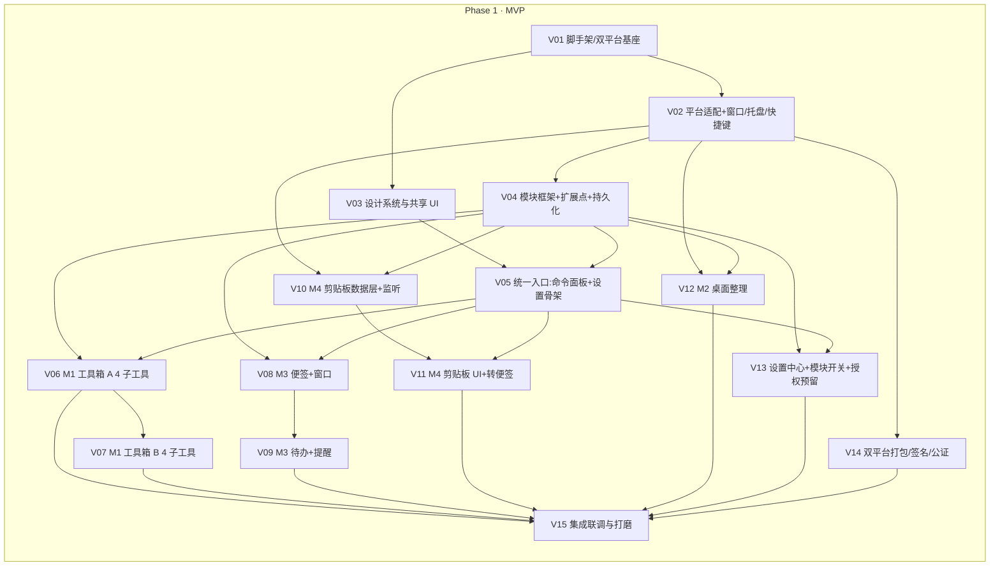

# Handy · 顺手 — 任务分解与实现计划

| 项目 | 内容 |
| --- | --- |
| 文档类型 | 任务分解与实现计划（TASKS）· **增量升级版** |
| 产品名 / 项目代号 | **Handy · 顺手** / `handy` |
| 文档版本 | **v2.0** |
| 目标平台 | Windows 10 1809+ / 11 · macOS 12+（Apple Silicon + Intel） |
| 上游文档 | `docs/02-architecture/ARCHITECTURE.md`、`docs/01-planning/PRD.md` |
| 范围约束 | **严格贴合 PRD v2 §5 MVP**：统一入口 + M1 工具箱(8 子工具) + M2 桌面整理(基础) + M3 便签/待办 + M4 剪贴板 + 双平台一键安装。截图/文件处理/系统优化/OCR/PDF/插件系统**不做**。 |

---

## 1. 依赖包清单 v2

### 1.1 前端依赖（`package.json`）

| 包 | 版本 | 用途 | 备注 |
| --- | --- | --- | --- |
| `react` / `react-dom` | ^18.3.1 | UI 框架 | 沿用 v1 |
| `zustand` | ^4.5.5 | 轻量状态（配置态 + 视图态） | 沿用 v1 |
| `cmdk` | ^1.0.0 | 命令面板（模糊 + 键盘导航） | 沿用 v1 |
| `lucide-react` | ^0.454.0 | 线性图标（按需具名导入） | 沿用 v1 |
| `clsx` / `tailwind-merge` / `class-variance-authority` | 最新 | className/变体工具 | 沿用 v1 |
| `@radix-ui/react-{dialog,popover,tabs,switch,slider,tooltip,toast,select,dropdown-menu}` | ^1.x | shadcn 原语 | 沿用 v1（新增 dropdown-menu 供模块侧栏） |
| `@tauri-apps/api` | ^2.0.0 | invoke/listen/window | 沿用 v1 |
| `@tauri-apps/plugin-store` | ^2.0.0 | **配置态**持久化 | 沿用（语义降级为配置） |
| **`@tauri-apps/plugin-sql`** | ^2.0.0 | **SQLite 数据层**（便签/待办/剪贴板/历史） | **v2 新增** |
| `@tauri-apps/plugin-clipboard-manager` | ^2.0.0 | 剪贴板读写 | 沿用 v1 |
| `@tauri-apps/plugin-dialog` | ^2.0.0 | 文件/目录对话框（桌面整理选择目录） | 沿用 v1 |
| `@tauri-apps/plugin-global-shortcut` | ^2.0.0 | 全局快捷键前端封装 | 沿用 v1 |
| `@tauri-apps/plugin-notification` | ^2.0.0 | 待办提醒系统通知 | **v2 新增** |
| `@tauri-apps/plugin-updater` | ^2.0.0 | 自动更新 | 沿用 v1 |
| `@tauri-apps/plugin-autostart` | ^2.0.0 | 开机自启 | 沿用 v1 |
| `@tauri-apps/plugin-process` | ^2.0.0 | 进程重启（提权/更新后重启） | 沿用 v1 |
| `@tauri-apps/plugin-os` | ^2.0.0 | 平台判定（辅助 `platform.ts`） | **v2 新增** |
| `fuse.js` | ^7.0.0 | 模糊搜索 | 沿用 v1 |
| `pinyin-pro` | ^3.26.0 | 拼音首字母匹配 | 沿用 v1 |
| `diff` | ^7.0.0 | 文本差异 | 沿用 v1（M1 文本差异） |
| **`qrcode`** | ^1.5.4 | 二维码生成（M1 子工具） | **v2 新增（MVP 内）** |
| `sonner` | ^1.7.0 | Toast | 沿用 v1 |
| **`date-fns`** | ^4.1.0 | 时间/日期（便签时间戳、提醒、桌面按日期整理） | **v2 新增** |

**开发依赖**

| 包 | 版本 | 用途 |
| --- | --- | --- |
| `typescript` | ^5.6.3 | 类型系统（strict） |
| `vite` / `@vitejs/plugin-react` | ^5.4.x / ^4.3.x | 构建 |
| `@tauri-apps/cli` | ^2.0.0 | Tauri CLI |
| `tailwindcss` / `postcss` / `autoprefixer` | ^3.4 / ^8.4 / ^10.4 | 样式 |
| `@types/react` / `@types/react-dom` / `@types/node` / `@types/qrcode` | 最新 | 类型 |

### 1.2 Rust 依赖（`src-tauri/Cargo.toml`）

| Crate | 版本 | 用途 | 平台 |
| --- | --- | --- | --- |
| `tauri` | ^2.0（features: `tray-icon`, `image-png`, `macos-private-api`） | 桌面运行时 | 全平台 |
| **`tauri-plugin-sql`** | 2（feature `sqlite`） | **SQLite 数据层** | 全平台 |
| `tauri-plugin-store` | 2 | 配置态持久化 | 全平台 |
| `tauri-plugin-global-shortcut` | 2 | 全局快捷键 | 全平台 |
| `tauri-plugin-single-instance` | 2 | 单实例 | 全平台 |
| `tauri-plugin-clipboard-manager` | 2 | 剪贴板读写 | 全平台 |
| `tauri-plugin-dialog` | 2 | 文件/目录对话框 | 全平台 |
| **`tauri-plugin-notification`** | 2 | 系统通知（提醒） | 全平台 |
| `tauri-plugin-updater` | 2 | 自动更新 | 全平台 |
| `tauri-plugin-autostart` | 2 | 开机自启 | 全平台 |
| `tauri-plugin-process` | 2 | 重启进程 | 全平台 |
| `tauri-plugin-shell` | 2 | `open` 外链/目录（受限白名单） | 全平台 |
| `tauri-plugin-log` | 2 | 本地日志 | 全平台 |
| `serde` / `serde_json` | 1 | 序列化 | 全平台 |
| `uuid` | 1（v4） | 便签/待办/剪贴板 id | 全平台 |
| `chrono` | 0.4 | 时间（提醒/日期归类） | 全平台 |
| `rusqlite` | 0.32（bundled） | SQL 类型/迁移辅助（经 sql 插件底层或直用） | 全平台 |
| `anyhow` / `thiserror` | 1 | 错误处理 | 全平台 |
| `dirs` | 5 | 系统目录（app_data/Desktop 路径） | 全平台 |
| `walkdir` | 2 | 目录遍历（桌面整理/文件枚举） | 全平台 |
| `sysinfo` | 0.32 | 系统信息/进程（M8 预留，MVP 仅系统信息用于设置页） | 全平台 |
| **`windows`** | 0.58（精简 features） | 桌面条目/进程 Win32 API | **仅 Windows** |
| **`objc2` / `objc2-foundation` / `objc2-app-kit`** | 最新 | macOS 桌面/通知/权限探测（降级实现） | **仅 macOS** |
| **`core-foundation`** | 0.9 | macOS 路径/权限（Desktop 授权） | **仅 macOS** |

> 平台限定依赖用 `[target.'cfg(...)'.dependencies]` 声明。版本以 `cargo add` / `npm i` 稳定版为准。

---

## 2. 共享知识 v2（跨文件约定）

### 2.1 命名与目录规范

- **模块 id**：全小写 `kebab-case`，如 `toolbox`、`notes`、`clipboard`、`desktop-organizer`。
- **命令（功能）id**：全局唯一 `kebab-case`，如 `timestamp`、`json-formatter`、`qr-code`。
- **模块目录**：`src/modules/<module-id>/index.ts`（导出 `ModuleMeta`）+ 视图/命令子文件。
- **窗口 label**：`main` / `settings` / `organizer` / `clip-quick` / `note-{id}`。
- **Rust 命令**：`snake_case`，按领域分文件 `src-tauri/src/commands/*.rs`，在 `commands/mod.rs` 汇总、`main.rs` 注册。
- **IPC 调用**：前端一律经 `src/lib/ipc.ts` 封装，禁止组件内直接 `invoke` 字符串。
- **DB 访问**：业务经 `src/core/data/*Service.ts`，禁止组件内拼 SQL。

### 2.2 模块注册的固定写法

```ts
// src/modules/notes/index.ts
import type { ModuleMeta } from '../../core/types';
import { NOTE_COMMANDS } from './commands';
import { TODOS, REMINDERS } from './commands';

export default {
  id: 'notes',
  name: '便签·待办',
  description: '桌面便签、任务清单与定时提醒',
  icon: 'StickyNote',
  order: 30,
  surface: ['window', 'panel', 'tray'],
  tier: 'free',
  keywords: ['便签', '待办', '提醒', 'note', 'todo'],
  capabilities: ['notify'],
  windowSpec: { kind: 'note', multi: true, frameless: true, alwaysOnTop: true },
  loadView: () => import('./NoteWindow'),
  contributes: {
    commands: [...NOTE_COMMANDS, ...TODOS, ...REMINDERS],
    settingsSection: { id: 'notes', title: '便签与待办', order: 20, render: () => null },
    trayItems: [{ id: 'new-note', label: '新建便签', onClick: () => ipc.windowOpenNote('') }],
  },
} satisfies ModuleMeta;
```

### 2.3 功能（命令）注册的固定写法

```ts
// src/modules/toolbox/commands/index.ts
import type { CommandMeta } from '../../../core/types';

export const TIMESTAMP: CommandMeta = {
  id: 'timestamp',
  moduleId: 'toolbox',
  name: '时间戳转换',
  description: '时间戳与日期时间互转，支持秒/毫秒与多时区',
  icon: 'Clock',
  aliases: ['ts', 'timestamp', 'sjc'],
  keywords: ['时间戳', 'timestamp', 'unix', '日期'],
  layout: 'split',
  tier: 'free',
  sensitive: false,
  isOnline: false,
  load: () => import('./TimestampConverter'),
};

export const COMMANDS: CommandMeta[] = [TIMESTAMP /*, ...8 个 */];
```

### 2.4 IPC 封装约定

```ts
// src/lib/ipc.ts（节选）
import { invoke } from '@tauri-apps/api/core';
async function call<T>(cmd: string, args?: Record<string, unknown>): Promise<T> {
  try { return await invoke<T>(cmd, args); }
  catch (e) { throw new Error(typeof e === 'string' ? e : (e as Error).message); }
}
export const ipc = {
  platformInfo: () => call<PlatformInfo>('platform_info'),
  // 便签
  noteList: () => call<Note[]>('note_list'),
  noteCreate: (input: NewNote) => call<Note>('note_create', { input }),
  noteUpdate: (id: string, patch: NotePatch) => call<Note>('note_update', { id, patch }),
  noteSetPosition: (id: string, geom: Geometry) => call<void>('note_set_position', { id, geom }),
  noteDelete: (id: string) => call<void>('note_delete', { id }),
  windowOpenNote: (id: string) => call<void>('window_open_note', { noteId: id }),
  // 待办 / 剪贴板 / 桌面整理 / 模块 / 授权 / 备份（略，见 ARCHITECTURE §6）
};
```

### 2.5 错误处理与安全约定

- Rust 命令统一返回 `Result<T, String>`，`String` 为面向用户的**中文可读信息**。
- 前端 `ipc.ts` 统一归一为 `Error`，组件 `try/catch` 后以 `sonner` toast 展示。
- 提权失败错误带 `NEED_ELEVATION` 标记，前端显示「以管理员/授权」引导。
- 高风险操作（桌面整理应用、清空剪贴板、删除便签）**二次确认**。
- 敏感内容（密码/密钥/JWT）**不落库、不进历史**；剪贴板 `sensitive` 项不入 `clip_items`。

### 2.6 平台判断写法

- **前端**：读 `src/platform/index.ts`（由 `platform_info` 命令注入），**禁止**散落 `navigator.userAgent`。
- **构建期**：`import.meta.env.DEV` 仅用于 dev/prod 分支，不用于平台判断。
- **Rust**：使用 `#[cfg(target_os = "windows")]` / `#[cfg(target_os = "macos")]` 条件编译，**禁止**运行时字符串判 OS 来做核心分支。

### 2.7 样式令牌

- 主色单一强调色（蓝/青），定义于 `tailwind.config.ts` `theme.extend.colors.brand`。
- 圆角：基准 `rounded-lg`(8px)，卡片 `rounded-xl`；间距以 4 的倍数（`p-4/gap-4/space-y-4`）。
- 分割线低对比 `border-border`，扁平优先、无重阴影。
- 深浅色用 CSS 变量 + `dark:` 前缀；MVP 保证浅色，深色可选。
- 字体：系统中文优先，栈含「Microsoft YaHei / PingFang SC / 思源黑体」。

### 2.8 TypeScript 严格模式

- `tsconfig.json`：`strict`、`noUncheckedIndexedAccess`、`noImplicitOverride` 开启。
- 禁 `any`（用 `unknown` + 收窄）；公共函数显式返回类型；构建前 `tsc --noEmit` 零错误。

---

## 3. 任务列表 v2（按实现顺序）

> 复杂度：**S** ≈ 0.5 天、**M** ≈ 1–2 天、**L** ≈ 3 天+。依赖 `—` 为无前置。分组对齐 PRD v2 §9 路线图。

| 任务号 | 标题 | 对应文件（主要） | 依赖 | 复杂度 | 验收标准 |
| --- | --- | --- | --- | --- | --- |
| **V01** | 项目脚手架与双平台工程基座 | `package.json`、`vite.config.ts`、`tsconfig*.json`、`tailwind.config.ts`、`postcss.config.js`、`index.html`、`src/main.tsx`、`src/App.tsx`、`src/index.css`、`rust-toolchain.toml`、`src-tauri/Cargo.toml`、`src-tauri/build.rs`、`src-tauri/tauri.conf.json`、`src-tauri/src/main.rs`、`src-tauri/icons/*`、`.gitignore`、`README.md` | — | M | Win 与 mac 上 `npm run tauri dev` 均可拉起空白窗口；`tsc --noEmit` 通过；Tailwind 生效；Rust release 体积 profile 已配；`tauri-plugin-sql` 可预加载 `handy.db` |
| **V02** | 平台适配层 + 窗口/托盘/快捷键/单实例 | `src-tauri/src/platform/{mod.rs,windows.rs,macos.rs}`、`src-tauri/src/window.rs`、`tray.rs`、`shortcut.rs`、`src-tauri/src/main.rs`、`capabilities/{default.json,desktop.json}`、`src/platform/{index.ts,detect.ts}`、`src/lib/ipc.ts`(骨架)、`src/types/*` | V01 | L | `platform_info` 返回 os/arch/能力位；主窗启动即隐藏；Win `Alt+Space` / mac `Option+Space` 呼出并聚焦；托盘/菜单栏含打开·设置·退出；关闭最小化到托盘；二次启动只唤起已有实例 |
| **V03** | 设计系统与共享 UI | `src/index.css`、`tailwind.config.ts`、`src/components/ui/*`、`src/components/{CommandShell,CopyButton,ResultBox,AppLayout,ModuleSidebar}.tsx`、`src/lib/utils.ts`、`src/lib/clipboard.ts` | V01 | M | 浅色扁平令牌统一；`CommandShell` 含标题栏/返回/收藏/历史/复制；基础组件（button/input/dialog/tabs/switch/toast/dropdown-menu）可用；模块侧栏可渲染 |
| **V04** | 模块框架核心：注册表 + 扩展点 + 持久化层 | `src/core/types.ts`、`moduleRegistry.ts`、`extensionPoints.ts`、`bootstrap.ts`、`src/lib/db.ts`、`src/lib/store.ts`、`src/stores/{useAppStore,useFavoritesStore,useRecentStore}.ts`、`src-tauri/src/db/{mod.rs,migrations.rs,schema.sql}`、`src-tauri/src/commands/app.rs`、`src-tauri/src/main.rs`(DB 初始化) | V02 | L | `import.meta.glob` 自动发现模块/命令；`registry.searchCommands/collect` 可用；SQLite 建表 + migration 生效；store 读写配置；模块启停持久化；新增命令**不改框架**即可被搜索到（A11） |
| **V05** | 统一入口：命令面板 + 智能建议 + 设置中心骨架 | `src/components/{CommandPalette,SearchSuggest,SettingsCenter}.tsx`、`src/lib/search.ts`、`src/lib/detect.ts`、`src/hooks/useHotkeyOpen.ts`、`src/hooks/useTheme.ts` | V03, V04 | L | 输入 ≤3 字符命中命令；支持拼音首字母；↑↓/Enter/Esc 全键盘；首屏收藏+最近；剪贴板建议条识别 JSON/JWT/时间戳/URL/Base64 并一键直达；设置中心按扩展点聚合分区 |
| **V06** | M1 工具箱 —— 编码/文本组 4 子工具 | `src/modules/toolbox/{index.ts,ToolboxView.tsx}`、`commands/{index.ts,TimestampConverter.tsx,JsonFormatter.tsx,Base64Codec.tsx,TextDiff.tsx}` | V04, V05 | L | 时间戳自动识别秒/毫秒+多时区；JSON 非法给行号、≥1MB 不卡；Base64 支持 UTF-8 编解码；Diff 行内/并排高亮正确；4 项注册进面板 |
| **V07** | M1 工具箱 —— 安全/网络/实用组 4 子工具 | `src/modules/toolbox/commands/{PasswordGenerator.tsx,UrlCodec.tsx,HashGenerator.tsx,QrCodeGenerator.tsx,index.ts(补)}` | V06 | L | 密码生成可复制+强度提示+默认不写历史；URL 编解码正确；哈希（文本 MD5/SHA1/SHA256）正确；二维码生成可保存；**累计 8 子工具**全部可用（A4） |
| **V08** | M3 便签 —— 数据层 + 便签窗口 | `src/core/data/{notesService.ts,bus.ts}`、`src/modules/notes/{index.ts,NoteWindow.tsx}`、`commands/index.ts`、`src/stores/useNotesStore.ts`、`src-tauri/src/commands/notes.rs`、`window.rs`(note 窗) | V04, V05 | L | 新建/编辑/换色/置顶便签；无边框多实例窗；关闭不删数据；几何（位置/尺寸/层级）持久化；重开恢复；跨重启数据不丢（A6） |
| **V09** | M3 便签 —— 待办 + 定时提醒 | `src/core/data/todosService.ts`、`src/modules/notes/{TodoView.tsx,ReminderScheduler.tsx}`、`commands/index.ts(补)`、`src-tauri/src/commands/{todos.rs}` | V08 | L | 待办增删改勾选、优先级、截止日；设提醒后到点触发系统通知（Win Toast / mac UNUserNotification）；便签↔待办互转；跨重启保留（A6） |
| **V10** | M4 剪贴板 —— 历史数据层 + 监听 | `src/core/data/clipboardService.ts`、`src-tauri/src/commands/clip.rs`、`src/hooks/useClipboardWatch.ts`、`src-tauri/src/platform`（读剪贴板） | V04, V02 | L | 后台监听剪贴板（节流）；写入 `clip_items` 去重 + 裁剪至最近 100；置顶/删除/清空；敏感内容不落库；手动读取兜底（mac 未授权时） |
| **V11** | M4 剪贴板 —— 历史 UI + 智能识别 + 转便签 | `src/modules/clipboard/{index.ts,ClipboardHistory.tsx,matchers.ts,commands/index.ts}`、`src/components/SearchSuggest.tsx`(接入) | V10, V05 | M | 历史列表可搜索/置顶/回贴；多格式（文本/路径/图片缩略占位）；识别 JSON/JWT/URL/时间戳并推荐；一键转便签（落库 + 打开便签窗）（A7） |
| **V12** | M2 桌面整理（基础版）—— plan/preview/apply/undo | `src/modules/desktop-organizer/{index.ts,OrganizerView.tsx,commands/index.ts}`、`src-tauri/src/commands/organizer.rs`、`src-tauri/src/platform/{windows.rs,macos.rs}`(枚举/移动) | V02, V04 | L | 一键整理→预览→确认→应用→一键撤销闭环；Win 可操作桌面条目 / mac 降级为文件归类；规则（按类型/日期）可配；应用前二次确认；撤销记录落 `organize_plans`（A5） |
| **V13** | 设置中心 + 模块开关 + 授权预留 + 备份导入导出 | `src/components/SettingsCenter.tsx`(完整)、`src/core/license.ts`、`src/core/moduleRegistry.ts`(启停)、`src/lib/backup.ts`、`src-tauri/src/commands/app.rs`(backup/module/license) | V05, V04 | M | 设置项：快捷键(冲突提示)/自启/主题/剪贴板监听与历史/清空记录；模块开关即时生效；Pro 门控占位（未解锁显示升级提示，不弹诱导付费）；全量备份/导入（db + store）可用 |
| **V14** | 双平台打包、签名、公证与自动更新 | `src-tauri/tauri.conf.json`(bundle/updater/sql)、`src-tauri/src/main.rs`(updater/autostart)、`src-tauri/entitlements.plist`、`src-tauri/Info.plist`、`.github/workflows/{ci.yml,release.yml}`、`scripts/{build-win.ps1,build-mac.sh,notarize.sh}`、`README.md`(构建说明) | V02（可与 V06–V13 并行收尾） | L | Win 出 `.msi`+`.exe` 且 <30MB；mac 出 `.dmg` 且 <40MB、含签名+公证（无「身份不明开发者」拦截）；WebView2 缺失检测引导；自动更新可检查/可关闭（A1/A2/A10） |
| **V15** | 集成联调、性能与打磨 | `src/App.tsx`、`src/main.tsx`(窗口分派)、`src/core/bootstrap.ts`、`src/components/{CommandPalette,CommandShell,SettingsCenter}.tsx`、`src/modules/*/index.ts`(联调) | V06–V13 | M | 全链路：呼出→搜索→模块/命令→复制→Esc 闭环；便签↔剪贴板↔待办数据互通；空态/错误态/加载态齐全；托盘空闲 <150MB、呼出 <300ms；离线全功能可用（A3/A8/A9/A12） |

**并行说明**：V06/V07（M1）、V08/V09（M3）、V10/V11（M4）、V12（M2）在各自前置完成后**可并行推进**；V14（打包）可与 V06–V13 并行准备。V01 是所有任务前置。

---

## 4. Phase 划分 v2

### Phase 1 · 效率套件 MVP（PRD v2 §9）—— 本文件 V01–V15 全量

**目标**：交付「能打动大众」的最小组合，并**双平台一键安装**。

| Phase 1 子阶段 | 任务 | 交付验收点 |
| --- | --- | --- |
| ① 脚手架与平台基座 | V01, V02 | 双平台可跑；平台能力位就绪；呼出/托盘/单实例闭环 |
| ② 设计系统与统一入口 | V03, V04, V05 | 命令面板全键盘可用；注册表可自动发现；SQLite 落库；设置中心骨架 |
| ③ M1 工具箱（8 子工具） | V06, V07 | 8 个通用子工具全部可用 |
| ④ M3 便签/待办 | V08, V09 | 便签多窗持久化；待办+提醒；互转 |
| ⑤ M4 剪贴板 | V10, V11 | 历史 100 条 + 搜索/置顶/回贴 + 转便签 |
| ⑥ M2 桌面整理（基础） | V12 | 整理→预览→应用→撤销闭环 |
| ⑦ 设置与授权预留 | V13 | 设置项完整；模块开关；Pro 门控占位；备份导入 |
| ⑧ 双平台打包 | V14 | MSI/NSIS + DMG 达标，签名/公证 |
| ⑨ 集成打磨 | V15 | MVP 验收 A1–A12 全通过 |

### Phase 2 · 效率增强（占位，不细拆）

- M5 快速启动/全局搜索（`palette.provider` 扩展到应用/文件）
- M6 截图套件（`ScreenshotOverlay` 窗口 + 屏幕录制授权 + 本地 OCR）
- M7 文件处理（批量改名/去重/磁盘分析，复用 v1 `file.rs` 与 `walkdir`）
- 验收：各模块独立可用；新增模块**不改框架**。

### Phase 3 · 系统与专业（占位）

- M8 系统优化/增强、M9 安全隐私、M10 媒体/PDF、**L2 官方扩展包机制跑通**、Pro 分层上线。

### Phase 4 · 生态与商业化（占位）

- L3 第三方插件市场（需用户拍板）、账号/可选云同步、商业化闭环。

---

## 5. 任务依赖图（Mermaid）



---

## 6. 待明确事项（需产品/用户拍板的架构级问题）

| # | 问题 | 影响 | 建议默认值 |
| --- | --- | --- | --- |
| ~~AQ1~~ | **产品名** ✅ **已定：`Handy · 顺手`**（PRD Q1 已拍板） | 包名/identifier/图标/DB 文件名/README | 统一用 **`handy`**：identifier `com.handy.desktop`、DB `handy.db`、托盘/应用名 `Handy · 顺手` |
| AQ2 | **macOS 优先级**（PRD Q2） | MVP 工期与 CI 资源 | 与 Windows 同步（H1 已定跨平台） |
| AQ3 | **持久化最终裁定**（本文件 ADR-7） | 数据层实现 | **SQLite 为主 + store 仅配置**（已给明确结论） |
| AQ4 | **剪贴板默认行为**（PRD Q3 / v1 同问） | 隐私观感 | 默认**开启监听**、历史默认**开启但上限 100**；敏感内容不落库；一键关闭/清空 |
| AQ5 | **Pro 门控边界**（PRD Q3） | 授权接口落地范围 | 本期仅 `tier` 字段 + `license` 接口 stub，**所有 MVP 功能 tier=free** |
| AQ6 | **macOS 桌面整理强度**（PRD Q6） | M2 工作量与预期 | mac **仅文件归类**，不做桌面图标收纳盒 |
| AQ7 | **是否引入 CI 自动化发版**（本期） | V14 范围 | 先落地**本地构建脚本**，CI 作为增强（可并行） |
| AQ8 | **深色主题是否进 MVP** | 设计令牌工作量 | 先浅色扁平；深色用 `dark:` 令牌**预留** |
| AQ9 | **自动更新端点与签名密钥托管** | V14 交付 | 先支持**手动检查更新**；端点/公钥在发版前提供 |
| AQ10 | **L2 扩展包是否本期验证** | 架构验证范围 | 本期仅**接口预留**，不实现下载/校验（PRD Q4：早期不做 L3） |

---

*本文档为 v2.0，配合 `ARCHITECTURE.md` 使用。任务粒度面向工程师逐个实现；范围严格受 PRD §5 MVP 约束，不膨胀。产品名 **Handy · 顺手**（identifier `com.handy.desktop`）。*
