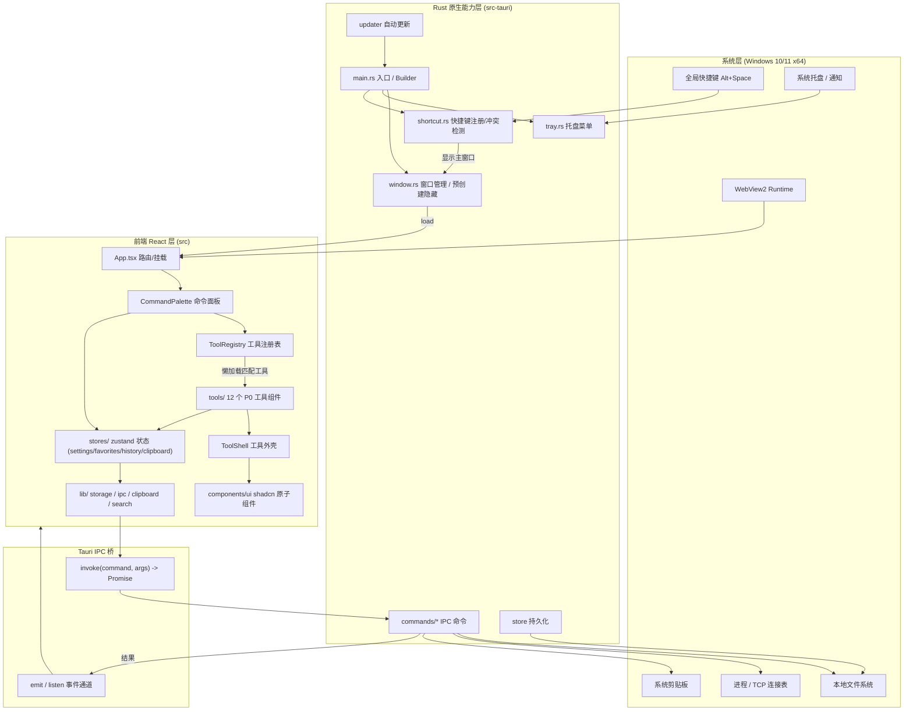
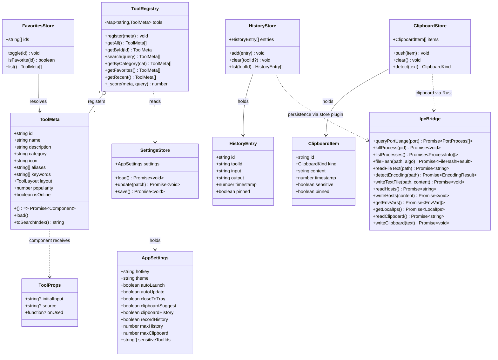
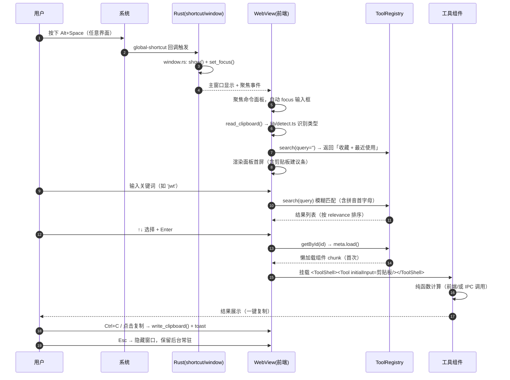
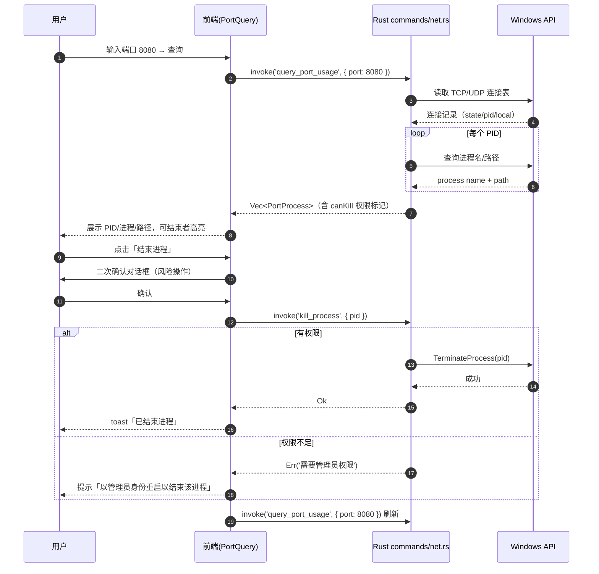
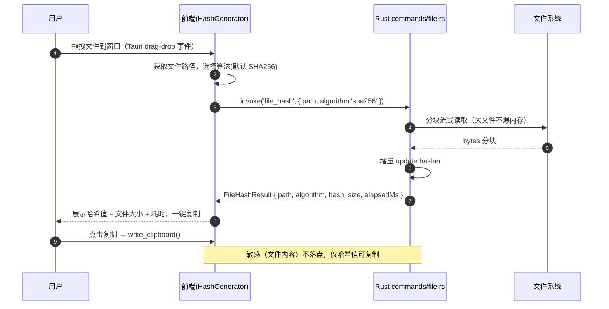

# 运维/开发高效工具箱（Windows 桌面版）— 系统架构设计

> 🗄️ **已归档（v1 历史文档，只读）**
> 本文为 **v1** 阶段版本；架构已于 v2 升级为跨平台（Win + macOS）+ 模块化可扩展设计（见 `docs/02-architecture/ARCHITECTURE.md`）。
> **当前权威文档**：`docs/01-planning/PRD.md`、`docs/02-architecture/ARCHITECTURE.md`、`docs/02-architecture/TASKS.md`、`docs/01-planning/DECISIONS.md`。本文仅作追溯保留，**不再维护**。

| 项目 | 内容 |
| --- | --- |
| 文档类型 | 系统架构设计（ARCHITECTURE） |
| 项目代号 | ops-toolbox-desktop |
| 项目路径 | `D:\_Projects\ops\ops-tools\ops-toolbox-desktop` |
| 参考项目 | `D:\_Projects\ops\ops-tools`（网页版，只读借鉴，**不得修改**） |
| 目标平台 | Windows 10 1809+ / Windows 11，x64 |
| 文档版本 | v1.0 |
| 上游文档 | `docs/01-planning/PRD.md` |

---

## 1. 技术选型与决策记录（ADR）

### ADR-1：桌面运行时 —— Tauri 2.x（Rust）**而非** Electron

**结论：采用 Tauri 2.x。**

| 维度 | Tauri 2.x | Electron | 对本产品的影响 |
| --- | --- | --- | --- |
| 安装包体积 | 复用系统 WebView2，**可做到 < 20MB 量级** | 打包整套 Chromium，**60–150MB** | PRD 非功能指标「安装包 < 80MB」→ Tauri 直接达标，Electron 逼近上限 |
| 空闲内存 | 共享系统 WebView2 进程，**托盘常驻 < 120MB 可达** | 每实例 ~150MB+ | PRD「托盘空闲 < 120MB」→ Tauri 有优势 |
| 冷启动 | Rust 二进制 + 系统 WebView，**< 1s 可达** | 需拉起 Node/Chromium | PRD「冷启动 < 1s」 |
| 系统集成 | 官方插件一等公民：`global-shortcut` / `tray` / `single-instance` / `autostart` / `updater` | 需社区模块拼装，主进程实现 | PRD P0 全部桌面能力开箱即用 |
| 本地文件/进程访问 | Rust 原生，含提权、进程结束、文件哈希 | Node.js 能力，进程操作较弱 | PRD 4.4 桌面专属能力 |
| 前端复用 | **纯 Web 前端，可最大化复用网页版 React 组件与纯函数** | 同 | 两者都满足 |
| 构建前置 | 首次需 Rust 工具链 + MSVC Build Tools | 仅 Node.js | **唯一劣势**，见风险 R1 |
| WebView 内核 | 依赖系统 WebView2（Win10 1809+ 多已内置） | 自带内核，完全一致 | 见风险 R2 |

**决策理由**：本产品的立身之本是「秒开、常驻、离线、系统集成、包小」，这正是 Tauri 相对 Electron 的强项；且前端是 Web 技术栈，网页版组件/算法可几乎零成本迁移。首次构建需 Rust 工具链的成本是一次性的开发环境成本，可接受。

**接受的代价**：① 构建环境需 Rust + MSVC；② 渲染一致性依赖系统 WebView2 版本；③ Rust/前端双语言心智成本。均已在下文风险章节给出缓解方案。

---

### ADR-2：前端 UI 方案 —— React 18 + TS + Vite + Tailwind 3 + shadcn/ui（Radix 原语）

**结论：不引入 MUI。**

- **React 18 + TypeScript 5 + Vite 5**：与网页版同源，组件与纯函数算法可直接搬迁；Vite 5 原生代码分割，便于工具懒加载。
- **Tailwind CSS 3**：原子化样式，产物小、可 Tree-shaking；契合 PRD「扁平、少层级、大量留白、克制分割线」的视觉方向。
- **shadcn/ui（基于 Radix 原语）**：不引入运行时组件库整体，而是按需 **拷贝源码** 到 `src/components/ui/`，产物只含用到的组件；Radix 提供无障碍、可键盘操作的原语（Dialog/Popover/Command），与「全键盘闭环」诉求高度契合。
- **拒绝 MUI**：MUI 全量体积大、Runtime CSS-in-JS 有额外开销，与「包小、秒开」目标冲突；网页版已有的 MUI 依赖不迁移。

> 说明：命令面板（Command Palette）使用 `cmdk`（Radix 生态，被 shadcn 的 `command` 组件封装），自带模糊搜索与键盘导航。

---

### ADR-3：本地持久化方案 —— Tauri `store` 插件（JSON 键值）**而非** localStorage / SQLite

**结论：默认使用 `tauri-plugin-store` 持久化为本地 JSON 文件。**

**为什么不使用 `localStorage`：**

| 问题 | 说明 |
| --- | --- |
| 数据与 WebView 同生共死 | localStorage 归属 WebView 的 origin，一旦清缓存/改 origin/换 identifier，数据全部丢失，且用户无法备份 |
| 容量限制 | 多数场景 ~5MB，剪贴板历史 + 各工具历史易触顶 |
| 同步阻塞 | 同步 API，写大对象会阻塞 UI 线程 |
| 无法被 Rust 读取 | 全局快捷键、托盘、开机自启等 Rust 侧需要在**前端未加载**时也能读写设置 |
| 无法就近备份 | 存储在不可见的 WebView 数据目录，用户无法导出 |

**为什么选 store（JSON）而非 SQLite：**

- 本产品数据模型是**少量、小体量、无关联查询**的键值：`settings`（1 份）、`favorites`（字符串数组）、`recentTools`、`history`（按工具分桶、带条数上限）、`clipboardHistory`（带条数上限）。**无需 SQL 的关系查询、索引、事务**。
- store 插件写入 `%APPDATA%`（或 `app_data_dir`）下的 JSON 文件，**前端（JS）与 Rust 侧均可读写**，天然满足「Rust 侧开机/快捷键需要读设置」。
- 体积极小（几乎零依赖），符合包体积目标。
- **触发切 SQLite 的条件**：若后续「剪贴板历史/工具历史」条数上限显著放大（如 > 1 万条）或需要全文检索/复杂过滤，再引入 `tauri-plugin-sql`（SQLite）；接口层已做封装（见 `src/lib/storage.ts`），迁移成本可控。

---

### ADR-4：Rust 侧与前端侧的职责边界

**原则：能纯计算就留给前端；只有「触达操作系统 / 依赖原生性能 / 需要提权」的能力才下沉到 Rust。**

| 归属 | 职责 | 典型内容 |
| --- | --- | --- |
| **前端（React/TS）** | 纯函数计算、UI、状态、搜索、剪贴板文本读写、格式化/编解码/生成器 | 时间戳转换、JSON 格式化、Base64 编解码、JWT 解码、密码生成、Diff、Cron 解析、Docker↔Compose、IP/CIDR、哈希（文本）、命令面板搜索、历史/收藏 UI |
| **Rust 原生能力层** | 系统交互、文件系统、进程、提权、窗口/托盘/快捷键、更新 | 端口占用查询、结束进程、**本地文件哈希**、读文件文本、编码检测、写文件、hosts 读写（提权）、环境变量、进程快照、自启、更新检查 |
| **前端 IPC 桥** | 统一封装 `invoke`，类型化命令签名与错误处理 | `src/lib/ipc.ts` |

**边界纪律**：
- **敏感数据（JWT / 密码 / 密钥）永不出前端内存、永不写盘**（仅内存态 + 剪贴板），Rust 侧不接收明文。
- 前端不直接使用 `fs` 插件的宽泛权限；所有文件访问走**自定义命令**，便于最小授权与审计。
- 需要提权的操作（写 hosts、结束其他用户进程）统一走**独立提权命令 + 明确的二次确认 UI**。

---

## 2. 整体架构图



---

## 3. 目录结构

> 遵循用户偏好：**扁平、少层级**。工具按大类分子目录，其余目录尽量不嵌套。

```
ops-toolbox-desktop/
├── docs/
│   ├── 01-planning/
│   │   └── PRD.md
│   └── 02-architecture/
│       ├── ARCHITECTURE.md
│       ├── TASKS.md
│       ├── sequence-diagram.mermaid
│       └── class-diagram.mermaid
├── package.json                      # 前端依赖与脚本 (dev/build/tauri)
├── vite.config.ts                    # Vite 配置（含 Tauri 固定端口、代码分割）
├── tsconfig.json / tsconfig.node.json
├── tailwind.config.ts                # Tailwind 设计令牌
├── postcss.config.js
├── index.html                        # 前端入口（Tauri 加载）
├── .gitignore / README.md
├── src/                              # ===== 前端 (React) =====
│   ├── main.tsx                      # React 挂载入口
│   ├── App.tsx                       # 顶层：路由（面板/设置）、全局快捷键事件监听
│   ├── index.css                     # Tailwind 指令 + 全局样式令牌
│   ├── components/
│   │   ├── ui/                       # shadcn 原子组件（button/input/dialog/command/tabs/toast…）
│   │   ├── CommandPalette.tsx        # 命令面板（核心界面）
│   │   ├── ToolShell.tsx             # 工具外壳：标题栏 + 返回 + 收藏 + 一键复制
│   │   ├── CopyButton.tsx            # 统一「一键复制」按钮 + toast
│   │   ├── ClipboardSuggest.tsx      # 剪贴板智能识别建议条（P1）
│   │   ├── SettingsPage.tsx          # 设置页
│   │   ├── ResultBox.tsx             # 统一结果展示区
│   │   └── AppLayout.tsx             # 面板/详情切换的外层布局
│   ├── tools/                        # ===== 12 个 P0 工具（按大类分）=====
│   │   ├── registry.ts               # 工具注册表（元数据数组 + 查询 API）
│   │   ├── types.ts                  # ToolMeta / ToolProps 等接口
│   │   ├── text/                     # 文本与数据
│   │   │   ├── JsonFormatter.tsx
│   │   │   ├── TextDiff.tsx
│   │   │   └── TextCompare.tsx       #（复用/合并）
│   │   ├── encoding/                 # 编码与格式
│   │   │   ├── TimestampConverter.tsx
│   │   │   ├── Base64Codec.tsx
│   │   │   └── JwtDecoder.tsx
│   │   ├── security/                 # 加密与安全
│   │   │   ├── PasswordGenerator.tsx
│   │   │   └── HashGenerator.tsx
│   │   ├── network/                  # 网络
│   │   │   ├── IpPlanner.tsx
│   │   │   └── PortQuery.tsx         # 本地端口占用（Rust 支撑）
│   │   └── devops/                   # 开发与运维
│   │       ├── CronPreview.tsx
│   │       └── DockerComposeConvert.tsx
│   ├── lib/
│   │   ├── ipc.ts                    # 类型化 invoke 封装 + 错误归一
│   │   ├── storage.ts                # 持久化抽象（封装 store 插件）
│   │   ├── clipboard.ts              # 剪贴板文本读写 + copyText
│   │   ├── search.ts                 # 模糊搜索 + 拼音首字母
│   │   ├── detect.ts                 # 剪贴板内容识别（JSON/JWT/时间戳/Base64/URL）
│   │   └── utils.ts                  # cn() 等通用工具
│   ├── stores/                       # zustand 状态（前端运行时态）
│   │   ├── useSettingsStore.ts
│   │   ├── useFavoritesStore.ts
│   │   ├── useHistoryStore.ts
│   │   └── useClipboardStore.ts
│   ├── hooks/
│   │   ├── useHotkeyOpen.ts          # 监听 Rust 事件，打开面板
│   │   ├── useClipboardWatch.ts      # 剪贴板感知
│   │   └── useToolExecution.ts       # 工具执行/历史写入统一封装
│   └── assets/                       # 图标等静态资源
└── src-tauri/                        # ===== Rust 原生能力层 =====
    ├── Cargo.toml
    ├── build.rs
    ├── tauri.conf.json               # 窗口/托盘/插件/打包配置
    ├── capabilities/
    │   └── default.json              # 最小化权限清单
    ├── icons/                        # 应用图标（多尺寸 .ico/.png）
    └── src/
        ├── main.rs                   # 入口：Builder、插件注册、命令注册
        ├── lib.rs                    # 可选：模块聚合（bin+lib）
        ├── window.rs                 # 主窗口预创建/显隐/失焦隐藏
        ├── tray.rs                   # 托盘图标与右键菜单
        ├── shortcut.rs               # 全局快捷键注册/更新/冲突检测
        └── commands/
            ├── mod.rs                # 命令聚合导出
            ├── net.rs                # query_port_usage / kill_process / process_list
            ├── file.rs               # file_hash / read_file_text / detect_encoding / write_text_file
            ├── system.rs             # hosts 读写 / env_vars / local_ips / autostart
            └── clipboard.rs          # read_clipboard / write_clipboard
```

**目录职责说明**

| 目录 | 职责 | 关键约定 |
| --- | --- | --- |
| `src/tools/` | 12 个 P0 工具的组件 + 注册表 | 新增工具 = 新增 1 个组件 + 1 条注册项 |
| `src/components/ui/` | shadcn 原子组件（拷贝式） | 只保留实际用到的组件 |
| `src/lib/` | 无状态工具函数与桥接层 | 纯函数优先，便于单测 |
| `src/stores/` | 运行时状态（zustand），并联动 `lib/storage.ts` 持久化 | 状态变更 → 自动落盘（防抖） |
| `src-tauri/src/commands/` | 所有 IPC 命令，按领域分文件 | 每个命令纯 Rust，返回 `Result<T, String>` |
| `src-tauri/capabilities/` | 权限白名单 | 最小授权，见第 9 节 |

---

## 4. 工具插件化注册机制（核心设计）

### 4.1 设计目标

「新增一个 P0/P1 工具」应当是**低成本、可预测**的动作，不需要改动框架代码：

1. 在 `src/tools/<大类>/` 新建一个组件文件，默认导出一个 `React.FC<ToolProps>`；
2. 在 `src/tools/registry.ts` 的数组中追加**一条 `ToolMeta`**（含懒加载 `load` 函数）；
3. 完成。命令面板搜索、收藏、历史、快捷键映射、一键复制外壳全部**自动生效**。

工具组件天然获得：统一外壳（`ToolShell`）、复制按钮、历史记录钩子、剪贴板预填、键盘闭环。

### 4.2 组件契约（`ToolProps`）

```ts
export interface ToolProps {
  /** 打开工具时的初始输入（来自剪贴板识别 / 命令面板 / 历史） */
  initialInput?: string;
  /** 触发来源，用于决定是否自动执行/是否写历史 */
  source?: 'clipboard' | 'history' | 'command' | 'manual';
  /** 工具可调用以把结果写入统一的「最近使用」 */
  onUsed?: (id: string) => void;
}
```

### 4.3 代码层组织（按大类分子目录）

| 大类子目录 | P0 工具 |
| --- | --- |
| `tools/text/` | JSON 格式化/转换、文本差异对比 |
| `tools/encoding/` | 时间戳转换、Base64 编解码、JWT 解码 |
| `tools/security/` | 密码生成器、哈希生成器（文本 + 本地文件） |
| `tools/network/` | IP/CIDR 规划、本地端口占用查询 |
| `tools/devops/` | Cron 预览、Docker run ↔ Compose |

---

## 5. 核心数据结构与接口

### 5.1 类图（Class Diagram）



### 5.2 TypeScript 接口定义

```ts
// ============ 工具核心 ============
export type ToolLayout = 'split' | 'tab' | 'form' | 'preview' | 'full';

export interface ToolMeta {
  id: string;                 // 唯一标识，如 'timestamp'
  name: string;               // 中文名，如 '时间戳转换'
  description: string;        // 一句话说明（用于搜索结果副标题）
  category: string;           // 大类 id，与 OPTIMIZED_CATEGORIES 对齐
  icon: string;               // lucide 图标名，如 'Clock'
  aliases: string[];          // 短别名：['ts', 'timestamp', 'sjc']
  keywords: string[];         // 搜索关键词（含拼音首字母）
  layout: ToolLayout;         // 布局壳
  popularity: number;         // 0-100，排序权重
  isOnline: boolean;          // 是否需联网（本产品 P0 全部 false）
  sensitive?: boolean;        // 敏感工具：默认不写历史/剪贴板（密码/密钥）
  load: () => Promise<{ default: React.ComponentType<ToolProps> }>; // 懒加载
}

export interface ToolProps {
  initialInput?: string;
  source?: 'clipboard' | 'history' | 'command' | 'manual';
  onUsed?: (id: string) => void;
}

// ============ 应用设置 ============
export interface AppSettings {
  hotkey: string;             // 默认 'Alt+Space'
  theme: 'light' | 'dark' | 'system';
  autoLaunch: boolean;        // 开机自启，默认 false
  autoUpdate: boolean;        // 自动更新检查，默认 true
  closeToTray: boolean;       // 关闭窗口→托盘，默认 true
  clipboardSuggest: boolean;  // 剪贴板智能识别，默认 true
  clipboardHistory: boolean;  // 剪贴板历史，默认 true
  recordHistory: boolean;     // 工具历史，默认 true
  maxHistory: number;         // 每工具历史条数上限，默认 50
  maxClipboard: number;       // 剪贴板历史条数上限，默认 100
  sensitiveToolIds: string[]; // 敏感工具 id（豁免记录）
}

// ============ 历史与剪贴板 ============
export interface HistoryEntry {
  id: string;                 // uuid
  toolId: string;
  input: string;              // 截断存储
  output: string;             // 截断存储
  timestamp: number;          // epoch ms
  pinned: boolean;
}

export type ClipboardKind =
  | 'text' | 'json' | 'jwt' | 'timestamp' | 'base64' | 'url';

export interface ClipboardItem {
  id: string;
  kind: ClipboardKind;
  content: string;
  timestamp: number;
  sensitive: boolean;
  pinned: boolean;
}

// ============ 桌面 IPC 结果模型 ============
export interface PortProcess {
  protocol: 'TCP' | 'UDP';
  localAddr: string;
  port: number;
  pid: number;
  processName: string;
  processPath: string;
  canKill: boolean;           // 是否当前权限可结束
}

export interface FileHashResult {
  path: string;
  algorithm: 'md5' | 'sha1' | 'sha256';
  hash: string;
  size: number;               // bytes
  elapsedMs: number;
}

export interface EncodingResult {
  path: string;
  encoding: string;           // 'UTF-8' | 'GBK' | 'UTF-16LE' ...
  hasBom: boolean;
  confidence: number;         // 0-1
}

export interface EnvVar { key: string; value: string; }

export interface LocalIps {
  hostname: string;
  ips: { name: string; addr: string; kind: 'ipv4' | 'ipv6' }[];
  gateway?: string;
}
```

### 5.3 前后端 IPC 命令契约（Rust `#[tauri::command]`）

> 统一约定：命令名 `snake_case`，前端 `invoke` 用同名；返回 `Result<T, String>`（错误为可读中文信息）。

| 命令 | 签名（Rust） | 用途 | 对应 PRD |
| --- | --- | --- | --- |
| `query_port_usage` | `fn query_port_usage(port: u16) -> Result<Vec<PortProcess>, String>` | 查询占用指定端口的进程列表 | P0-14 |
| `kill_process` | `fn kill_process(pid: u32) -> Result<(), String>` | 结束指定 PID 进程（提权策略见 9.2） | P0-14 |
| `list_processes` | `fn list_processes(sort_by: String) -> Result<Vec<ProcessInfo>, String>` | 进程/CPU/内存快查 | P1-7 |
| `file_hash` | `fn file_hash(path: String, algorithm: String) -> Result<FileHashResult, String>` | 本地文件哈希（流式，支持大文件） | P0-10 / P1-4 |
| `read_file_text` | `fn read_file_text(path: String) -> Result<String, String>` | 读取文本文件（对比/Base64/JSON） | P0-7/P0-8 |
| `detect_encoding` | `fn detect_encoding(path: String) -> Result<EncodingResult, String>` | 文件编码检测 | P1-4 |
| `write_text_file` | `fn write_text_file(path: String, content: String) -> Result<(), String>` | 写文本（换行符/编码转换输出） | P1-5 |
| `read_hosts` | `fn read_hosts() -> Result<String, String>` | 读取 hosts 内容 | P1-8 |
| `write_hosts` | `fn write_hosts(content: String) -> Result<(), String>` | 写 hosts（自动备份 + 提权） | P1-8 |
| `get_env_vars` | `fn get_env_vars() -> Result<Vec<EnvVar>, String>` | 查看环境变量 | P1-9 |
| `get_local_ips` | `fn get_local_ips() -> Result<LocalIps, String>` | 本机 IP/网关速查 | P1-11 |
| `list_directory` | `fn list_directory(path: String) -> Result<Vec<DirEntry>, String>` | 批量重命名/转换时枚举目录 | P1-5/P1-6 |
| `rename_files` | `fn rename_files(plan: Vec<RenamePair>) -> Result<(), String>` | 批量重命名（带校验） | P1-6 |
| `read_clipboard` | `fn read_clipboard() -> Result<String, String>` | 读取剪贴板文本 | P1-1/P1-2 |
| `write_clipboard` | `fn write_clipboard(text: String) -> Result<(), String>` | 写入剪贴板 | P0-15 |
| `set_autostart` | `fn set_autostart(enabled: bool) -> Result<(), String>` | 开机自启开关 | P1-20 |
| `update_hotkey` | `fn update_hotkey(accelerator: String) -> Result<bool, String>` | 更新全局快捷键，返回是否注册成功（冲突检测） | P0-1 |
| `open_in_explorer` | `fn open_in_explorer(path: String) -> Result<(), String>` | 定位文件（右键菜单铺垫） | P2-10 |

> 说明：`update_hotkey` 的成功与否由 Rust 侧 `global-shortcut` 插件真实注册结果决定，前端据此提示「冲突请改键」。

---

## 6. 关键流程时序图

### 6.1 全局快捷键呼出 → 命令面板 → 选中工具 → 执行



### 6.2 本地端口查询 → 结束进程



### 6.3 本地文件拖拽哈希



---

## 7. 全局快捷键 / 托盘 / 单实例技术实现要点

统一在 `src-tauri/src/main.rs` 的 `Builder` 中注册插件与能力。

| 能力 | 插件 / API | 关键配置与要点 |
| --- | --- | --- |
| **全局快捷键** | `tauri-plugin-global-shortcut`（Tauri 2 官方） | 启动时 `app.global_shortcut().on_shortcut("Alt+Space", handler)`；handler 内 `window.show()` + `window.set_focus()`。改键：先 `unregister(old)` 再 `register(new)`，**捕获注册失败**（返回 `Ok(false)`）以做冲突提示。`tauri.conf.json` 不声明默认键，改由 Rust 运行时读 `settings.hotkey` 注册。 |
| **系统托盘** | 内置 `tauri::tray::TrayIconBuilder`（feature `tray-icon`） | 托盘菜单项：打开 / 设置 / 退出；左键点击 toggle 主窗口显隐；关闭事件拦截改为隐藏（`close_to_tray`）。菜单事件在 `tray.rs` 的 `on_menu_event` 处理。 |
| **单实例** | `tauri-plugin-single-instance`（**必须最先注册**） | `Builder::plugin(tauri_plugin_single_instance::init(|app, argv, cwd| { /* 唤起已有窗口 */ }))`。第二次启动时回调 focus 已有实例，不新建进程。 |
| **开机自启** | `tauri-plugin-autostart` | `autolaunch()` 初始化，`enable()/disable()` 由设置页调用，默认关闭。 |
| **自动更新** | `tauri-plugin-updater` | 配置 `tauri.conf.json` 的 `plugins.updater.endpoints` 与公钥；启动后静默 `check()`，有更新弹轻提示，支持「跳过版本」。 |
| **窗口预创建** | `WebviewWindowBuilder` | 启动即创建主窗口但 `visible(false)`；快捷键呼出仅 `show()/set_focus()`，避免重复冷启动，满足首帧 < 300ms。 |
| **失焦隐藏** | `window.on_window_event(Focused(false))` | 可选：`hide_on_blur` 时失焦自动隐藏（设置项）。 |

**注册顺序注意**：`single-instance` 必须是第一个注册的插件，否则无法拦截二次启动。

---

## 8. 性能与包体积达成路径

| 指标（PRD 第 7 节） | 目标 | 达成手段 |
| --- | --- | --- |
| 冷启动到可交互 | < 1s | ① Tauri 二进制小、无 Node/Chromium 冷启；② 主窗口**启动即预创建并隐藏**；③ 前端首屏只挂载命令面板，工具全部懒加载；④ Vite 生产构建 + 体积压缩。 |
| 快捷键呼出首帧 | < 300ms | 进程常驻 + 窗口预创建，呼出仅显隐；命令面板首屏数据（收藏/最近）内存缓存，不触发 IPC 阻塞渲染。 |
| 安装包体积 | < 80MB（Tauri 目标 <20MB 量级） | ① 复用系统 WebView2，不打包内核；② Rust release profile 优化（见下）；③ 前端按工具代码分割，chunk 按需；④ `strip` 符号、`lto`、`opt-level="s"`。 |
| 托盘空闲内存 | < 120MB | 复用系统 WebView2 进程；工具懒加载，不用即释放；大文件处理在 Rust 侧流式进行，不在前端驻留。 |
| 单工具峰值 | < 250MB | 大文本/文件走 Rust 流式 API；Diff 采用分块；避免一次性把超大文件读入 JS 堆。 |

**Rust release 优化 profile（`Cargo.toml`）：**

```toml
[profile.release]
opt-level = "s"     # 体积优先（如需速度可改 3）
lto = true          # 链接时优化
codegen-units = 1   # 更小的产物
panic = "abort"     # 减小体积、去掉 unwind
strip = true        # 去除符号
```

**前端体积手段**：`vite.config.ts` 中 `build.rollupOptions.output.manualChunks` 拆出 vendor；工具统一用 `React.lazy` / 动态 `import()`；`lucide-react` 按需具名导入（Tree-shaking）；不引入 MUI。

---

## 9. 安全与权限

### 9.1 Tauri capabilities / permissions 最小化授权清单

原则：**只开必需**，所有文件访问走自定义命令而非宽泛 `fs` 权限。

| 插件/能力 | 授予权限 | 说明 |
| --- | --- | --- |
| `core` | `core:default` | 基础事件/窗口 API |
| `global-shortcut` | `global-shortcut:allow-register` / `allow-unregister` / `allow-is-registered` | 仅快捷键注册 |
| `single-instance` | 插件默认 | 无需额外权限声明 |
| `store` | `store:default` | 本地设置/历史持久化 |
| `clipboard-manager` | `clipboard-manager:allow-read-text` / `allow-write-text` | 仅文本，不做图像（P0 范围） |
| `dialog` | `dialog:allow-open` / `allow-save` | 文件选择/保存对话框 |
| `updater` | `updater:default` | 更新检查 |
| `autostart` | `autostart:default` | 开机自启 |
| `shell`（如用） | 仅 `open`（外链/hosts 目录）**白名单** | 禁 shell 执行任意命令 |
| `fs` | **不授予宽泛权限**；如需对话框选定后的读写，仅用 `dialog` 返回路径 + 自定义命令 | 最小面积 |

### 9.2 提权操作处理策略

涉及**结束他人进程、写 hosts、写系统目录**等需管理员权限的操作：

- 命令内先尝试普通权限执行；失败（`PermissionDenied`）时**返回结构化错误**，由前端提示「需要管理员权限」。
- 提供「以管理员身份重启」按钮，通过 `tauri-plugin-shell` 的 `runas` 以 elevated 方式重启自身（或引导用户右键以管理员运行）。
- hosts 写入前**自动备份**原文件到同目录 `.bak`（带时间戳），失败可回滚。
- 所有高风险操作（结束进程、写 hosts、批量重命名）前端**强制二次确认**。

### 9.3 敏感工具不落盘

- `sensitive: true` 的工具（密码生成器、AES/RSA/密钥类）：**结果不进历史、不进剪贴板历史**，仅内存态 + 用户显式复制。
- JWT / 密钥 / hosts 内容**不写入任何 store**，Rust 侧不接收敏感明文（JWT 解码纯前端完成）。
- 不集成任何统计/追踪；无网络请求（除可选的自动更新检查）。

---

## 10. 已识别风险与缓解

| # | 风险 | 影响 | 缓解方案 |
| --- | --- | --- | --- |
| R1 | **首次构建需 Rust 工具链 + MSVC Build Tools** | 开发者环境搭建成本、CI 复杂 | README 固化环境准备步骤；提供 `rust-toolchain.toml` 锁定版本；CI 使用预装镜像 |
| R2 | **WebView2 依赖**（Win10 1809+ 多已内置，极老系统可能缺失） | 老机器无法启动 | 安装器内置 WebView2 Bootstrapper（`webviewInstallMode: downloadBootstrapper` 或 embedded）；启动检测缺失时给出安装引导 |
| R3 | **全局快捷键与输入法/系统冲突** | 呼出失败、误触 | 注册失败即返回 `Ok(false)`，前端提示并引导改键；提供冲突检测与备选键位（`Ctrl+Shift+Space`） |
| R4 | **非管理员权限下端口查询/Hosts** | 结果不全或写入失败 | 降级：查询显示可得结果 + 标注「部分信息需管理员」；写入失败给出提权引导 |
| R5 | 剪贴板监听频率过高耗电/打扰 | 体验与资源占用 | 轮询做节流（如 500ms）；尊重 `clipboardSuggest` 开关；敏感内容不记录 |
| R6 | 大文件哈希/读取耗尽内存 | 卡顿/崩溃 | Rust 侧流式分块处理；前端不整体载入；设文件大小阈值提示 |
| R7 | 自动更新签名/发布链路 | 更新不可用 | 使用 Tauri updater 签名密钥；先支持「手动检查更新」，自动更新作为可关闭增强 |
| R8 | 工具数量增长带来搜索质量下降 | 「做减法」定位被侵蚀 | 注册表按 `popularity` + 收藏/最近加权排序；搜索评分函数集中在 `TaskRegistry._score`，可调 |
| R9 | 深浅色主题一致性 | 视觉割裂 | 以 CSS 变量 + Tailwind `dark:` 统一令牌；MVP 先保证浅色扁平，深色作为可选项 |

---

## 附录：与网页版复用映射

| 网页版资产（只读借鉴） | 桌面版处理 |
| --- | --- |
| `optimizedTools.ts` 工具元数据 | 提炼为 `ToolMeta`，**只保留 P0/P1**，去掉 SEO/流行度冗余字段 |
| `tools/*` 各工具纯函数算法（JSON/时间戳/Base64/JWT/Cron/Docker/IP） | **直接迁移**到 `src/tools/<大类>/` 组件内或 `lib/` |
| `layouts/*`（Full/Split/Tab/Form/Preview） | 简化为 `ToolShell` + 少量布局，`ToolLayout` 类型沿用 |
| `toolRegistry.ts`（class 版注册表） | 简化为函数式 `registry.ts`，去掉 analytics/cache |
| 路由/SEO/上传下载 | **不迁移**（改为命令面板 + 本地文件 I/O） |
| localStorage | 改为 Tauri `store` 持久化 |

---

*本文档为 v1.0，配合 `TASKS.md` 使用。技术选型已采纳 PRD 待确认项 Q1=A(Tauri)、Q2=仅 Windows、Q3/Q4=无云无账号、Q7=不做插件系统。*
