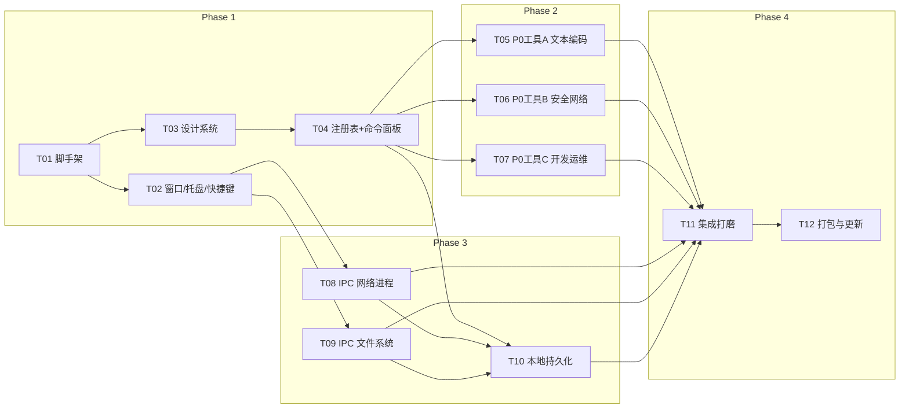

# 运维/开发高效工具箱（Windows 桌面版）— 任务分解与实现计划

> 🗄️ **已归档（v1 历史文档，只读）**
> 本文为 **v1** 阶段任务计划（T01–T12），已被 v2 的 `docs/02-architecture/TASKS.md`（V01–V15）取代。
> **当前权威文档**：`docs/01-planning/PRD.md`、`docs/02-architecture/ARCHITECTURE.md`、`docs/02-architecture/TASKS.md`、`docs/01-planning/DECISIONS.md`。本文仅作追溯保留，**不再维护**。

| 项目 | 内容 |
| --- | --- |
| 文档类型 | 任务分解与实现计划（TASKS） |
| 项目代号 | ops-toolbox-desktop |
| 上游文档 | `docs/02-architecture/ARCHITECTURE.md`、`docs/01-planning/PRD.md` |
| 文档版本 | v1.0 |

---

## 1. 依赖包清单

### 1.1 前端依赖（`package.json`）

| 包 | 版本 | 用途 |
| --- | --- | --- |
| `react` | ^18.3.1 | UI 框架 |
| `react-dom` | ^18.3.1 | DOM 渲染 |
| `zustand` | ^4.5.5 | 轻量状态管理（settings/favorites/history/clipboard） |
| `cmdk` | ^1.0.0 | 命令面板（模糊搜索 + 键盘导航） |
| `lucide-react` | ^0.454.0 | 线性图标（按需具名导入，Tree-shaking） |
| `clsx` | ^2.1.1 | 条件 className |
| `tailwind-merge` | ^2.5.4 | Tailwind 类合并 |
| `class-variance-authority` | ^0.7.0 | 组件变体（shadcn 依赖） |
| `@radix-ui/react-dialog` | ^1.1.2 | 弹层/对话框原语 |
| `@radix-ui/react-popover` | ^1.1.2 | 浮层原语 |
| `@radix-ui/react-tabs` | ^1.1.1 | 标签页原语 |
| `@radix-ui/react-switch` | ^1.1.1 | 开关原语 |
| `@radix-ui/react-slider` | ^1.2.1 | 滑块原语 |
| `@radix-ui/react-tooltip` | ^1.1.3 | 提示原语 |
| `@radix-ui/react-toast` | ^1.2.2 | 轻提示原语 |
| `@radix-ui/react-select` | ^2.1.2 | 下拉选择原语 |
| `@tauri-apps/api` | ^2.0.0 | Tauri 前端 API（invoke/listen/window） |
| `@tauri-apps/plugin-clipboard-manager` | ^2.0.0 | 剪贴板读写前端封装 |
| `@tauri-apps/plugin-dialog` | ^2.0.0 | 文件选择/保存对话框 |
| `@tauri-apps/plugin-global-shortcut` | ^2.0.0 | 全局快捷键前端封装 |
| `@tauri-apps/plugin-store` | ^2.0.0 | 本地持久化前端封装 |
| `@tauri-apps/plugin-updater` | ^2.0.0 | 自动更新前端封装 |
| `@tauri-apps/plugin-autostart` | ^2.0.0 | 开机自启前端封装 |
| `@tauri-apps/plugin-process` | ^2.0.0 | 进程重启（提权重启） |
| `fuse.js` | ^7.0.0 | 模糊搜索（工具名/别名/关键词） |
| `pinyin-pro` | ^3.26.0 | 中文拼音首字母匹配（'sjc'→时间戳） |
| `diff` | ^7.0.0 | 文本差异算法（jsdiff） |
| `js-yaml` | ^4.1.0 | JSON↔YAML 转换 |
| `cron-parser` | ^4.9.0 | Cron 表达式解析（计算未来执行时间） |
| `cronstrue` | ^2.50.0 | Cron 表达式中文自然语言解释 |
| `bcryptjs` | ^2.4.3 | （P1）Bcrypt | 
| `uuid` | ^10.0.0 | （P1）UUID 生成 |
| `sonner` | ^1.7.0 | Toast 通知（沿用网页版风格） |
| `prettier` | ^3.3.3 | SQL/JSON 格式化（P1 复用） |

**开发依赖**

| 包 | 版本 | 用途 |
| --- | --- | --- |
| `typescript` | ^5.6.3 | 类型系统（启用 strict） |
| `vite` | ^5.4.10 | 构建工具 |
| `@vitejs/plugin-react` | ^4.3.3 | React 插件 |
| `@tauri-apps/cli` | ^2.0.0 | Tauri CLI（dev/build） |
| `tailwindcss` | ^3.4.14 | 原子化 CSS |
| `postcss` | ^8.4.47 | CSS 处理 |
| `autoprefixer` | ^10.4.20 | 前缀补全 |
| `@types/react` / `@types/react-dom` | ^18.3.x | React 类型 |
| `@types/node` | ^22.8.0 | Node 类型 |
| `@types/js-yaml` | ^4.0.9 | YAML 类型 |
| `@types/diff` | （随 diff 内置） | Diff 类型 |

### 1.2 Rust 依赖（`src-tauri/Cargo.toml`）

| Crate | 版本 | 用途 |
| --- | --- | --- |
| `tauri` | ^2.0（features: `tray-icon`, `image-png`） | 桌面运行时 |
| `tauri-plugin-global-shortcut` | 2 | 全局快捷键 |
| `tauri-plugin-single-instance` | 2 | 单实例 |
| `tauri-plugin-store` | 2 | 本地持久化 |
| `tauri-plugin-clipboard-manager` | 2 | 剪贴板 |
| `tauri-plugin-dialog` | 2 | 文件对话框 |
| `tauri-plugin-updater` | 2 | 自动更新 |
| `tauri-plugin-autostart` | 2 | 开机自启 |
| `tauri-plugin-process` | 2 | 重启进程（提权） |
| `tauri-plugin-shell` | 2 | `open` 外链/目录（受限） |
| `serde` / `serde_json` | 1 | 序列化 |
| `sysinfo` | 0.32 | 进程/CPU/内存/网络接口 |
| `netstat2` | 0.9 | 读取本地 TCP/UDP 连接与 PID |
| `md-5` | 0.10 | 文件/文本 MD5 |
| `sha1` | 0.10 | SHA1 |
| `sha2` | 0.10 | SHA256 |
| `hex` | 0.4 | 哈希十六进制编码 |
| `chardetng` | 0.1 | 编码探测 |
| `encoding_rs` | 0.8 | 编码转换（GBK/UTF-16 等） |
| `dirs` | 5 | 系统目录（appdata/hosts 路径） |
| `walkdir` | 2 | 目录遍历（批量操作） |
| `windows` | 0.58（features 精简） | 结束进程 / 提权相关 Win32 API |
| `anyhow` | 1 | 错误处理 |
| `thiserror` | 1 | 命令错误类型 |
| `log` / `tauri-plugin-log` | 2 | 日志 |

> 版本号以 `cargo add` / `npm i` 时的最新稳定版为准，表中为设计基准。

---

## 2. 共享知识（跨文件约定）

### 2.1 命名与目录规范

- **工具 id**：全小写 `kebab-case`，如 `timestamp`、`json-formatter`、`port-query`。
- **组件文件**：`PascalCase.tsx`，默认导出一个 `React.FC<ToolProps>`。
- **注册项**：每个工具在 `src/tools/registry.ts` 的 `TOOLS` 数组中追加一条 `ToolMeta`，`load` 用 `() => import('./<大类>/<文件>')`。
- **Rust 命令**：`snake_case`，按领域分文件放入 `src-tauri/src/commands/`，在 `commands/mod.rs` 汇总，在 `main.rs` 的 `invoke_handler` 注册。
- **IPC 调用**：**前端一律通过 `src/lib/ipc.ts` 封装调用**，禁止在组件里直接 `invoke` 字符串常量。

### 2.2 工具注册的固定写法

```ts
// src/tools/registry.ts
export const TOOLS: ToolMeta[] = [
  {
    id: 'timestamp',
    name: '时间戳转换',
    description: '时间戳与日期时间互转，支持秒/毫秒与多时区',
    category: 'encoding-decoding',
    icon: 'Clock',
    aliases: ['ts', 'timestamp', 'sjc'],
    keywords: ['时间戳', 'timestamp', 'unix', '日期'],
    layout: 'split',
    popularity: 100,
    isOnline: false,
    load: () => import('./encoding/TimestampConverter'),
  },
  // ...其余 11 个 P0 工具
];
```

### 2.3 IPC 调用统一封装

```ts
// src/lib/ipc.ts
import { invoke } from '@tauri-apps/api/core';
import type { PortProcess, FileHashResult, EncodingResult, EnvVar, LocalIps } from '../types/desktop';

/** 统一错误归一：Rust 返回 Err(String) 会被抛出为 Error */
async function call<T>(cmd: string, args?: Record<string, unknown>): Promise<T> {
  try {
    return await invoke<T>(cmd, args);
  } catch (e) {
    throw new Error(typeof e === 'string' ? e : (e as Error).message);
  }
}

export const ipc = {
  queryPortUsage: (port: number) => call<PortProcess[]>('query_port_usage', { port }),
  killProcess: (pid: number) => call<void>('kill_process', { pid }),
  fileHash: (path: string, algorithm: string) => call<FileHashResult>('file_hash', { path, algorithm }),
  readFileText: (path: string) => call<string>('read_file_text', { path }),
  detectEncoding: (path: string) => call<EncodingResult>('detect_encoding', { path }),
  writeHosts: (content: string) => call<void>('write_hosts', { content }),
  getEnvVars: () => call<EnvVar[]>('get_env_vars'),
  getLocalIps: () => call<LocalIps>('get_local_ips'),
  readClipboard: () => call<string>('read_clipboard'),
  writeClipboard: (text: string) => call<void>('write_clipboard', { text }),
  updateHotkey: (accel: string) => call<boolean>('update_hotkey', { accelerator: accel }),
  setAutostart: (enabled: boolean) => call<void>('set_autostart', { enabled }),
};
```

### 2.4 错误处理约定

- Rust 命令统一返回 `Result<T, String>`，`String` 为**面向用户的中文可读信息**。
- 前端 `ipc.ts` 统一捕获并抛出 `Error`；组件内 `try/catch` 后以 `sonner` toast 展示。
- 高风险操作（结束进程、写 hosts、批量重命名）**必须二次确认**后再调用。
- 需要提权的失败，错误信息中带 `NEED_ELEVATION` 标记，前端据此显示「以管理员重启」入口。

### 2.5 样式约定（Tailwind 令牌）

- 主色：单一强调色（蓝/青），定义在 `tailwind.config.ts` 的 `theme.extend.colors.brand`。
- 圆角：统一 `rounded-lg`（8px）为基准，卡片 `rounded-xl`。
- 间距：以 4 的倍数为基准（`p-4` / `gap-4` / `space-y-4`，与网页版工具统一布局一致）。
- 分割线：`border-border`（低对比），避免重阴影；扁平优先。
- 深浅色：用 CSS 变量（HSL）+ `dark:` 前缀；MVP 保证浅色，深色可选。
- 字体：系统中文优先 `font-sans`，栈含「Microsoft YaHei / 思源黑体」。

### 2.6 TypeScript 严格模式要求

- `tsconfig.json` 开启：`"strict": true`、`"noUncheckedIndexedAccess": true`、`"noImplicitOverride": true`。
- 禁止 `any`（必要时用 `unknown` + 收窄）；公共函数必须显式返回类型。
- 工具组件 props 必须实现 `ToolProps`。
- 构建前 `tsc --noEmit` 必须零错误。

---

## 3. 任务列表（按实现顺序）

> 复杂度：**S** = 0.5 天内，**M** = 1–2 天，**L** = 3 天以上。
> 依赖：`—` 表示无前置；任务可并行时在依赖中标注（多个任务仅依赖同一前置即可并行）。

| 任务号 | 标题 | 对应文件（主要） | 依赖 | 复杂度 | 验收标准 |
| --- | --- | --- | --- | --- | --- |
| **T01** | 项目脚手架初始化 | `package.json`、`vite.config.ts`、`tsconfig*.json`、`tailwind.config.ts`、`postcss.config.js`、`index.html`、`src/main.tsx`、`src/App.tsx`、`src/index.css`、`src-tauri/Cargo.toml`、`src-tauri/build.rs`、`src-tauri/tauri.conf.json`、`src-tauri/src/main.rs`、`src-tauri/icons/*`、`.gitignore`、`README.md` | — | M | `npm run tauri dev` 能拉起一个空白窗口；`tsc --noEmit` 通过；Tailwind 生效；Rust release profile 已配置 |
| **T02** | Tauri 窗口 / 托盘 / 快捷键 / 单实例基础 | `src-tauri/src/window.rs`、`tray.rs`、`shortcut.rs`、`src-tauri/src/main.rs`、`src-tauri/capabilities/default.json`、`src/hooks/useHotkeyOpen.ts`、`src/lib/ipc.ts`(骨架)、`src/types/desktop.ts` | T01 | L | 主窗口启动即隐藏；`Alt+Space` 可显隐并聚焦；托盘图标右键含打开/设置/退出；关闭窗口最小化到托盘；二次启动只唤起已有实例 |
| **T03** | 设计系统（主题令牌 + 基础组件 + 工具外壳） | `src/index.css`、`tailwind.config.ts`、`src/components/ui/*`、`src/components/ToolShell.tsx`、`src/components/CopyButton.tsx`、`src/components/ResultBox.tsx`、`src/components/AppLayout.tsx`、`src/lib/utils.ts`、`src/lib/clipboard.ts` | T01 | M | 浅色扁平主题统一；`ToolShell` 含标题栏/返回/收藏/历史；`CopyButton` 复制后 toast；基础组件（button/input/dialog/tabs/switch）可用 |
| **T04** | 工具注册表 + 命令面板 | `src/tools/types.ts`、`src/tools/registry.ts`、`src/components/CommandPalette.tsx`、`src/components/ClipboardSuggest.tsx`、`src/lib/search.ts`、`src/lib/detect.ts`、`src/stores/useFavoritesStore.ts`、`src/stores/useHistoryStore.ts` | T03 | L | 输入 ≤3 字符命中常用工具；支持拼音首字母（'sjc'→时间戳）；↑↓/Enter/Esc 全键盘；首屏显示收藏+最近使用；剪贴板建议条可识别 JWT/JSON/时间戳/Base64/URL |
| **T05** | P0 工具组 A —— 文本与编码（4 个） | `src/tools/text/JsonFormatter.tsx`、`src/tools/text/TextDiff.tsx`、`src/tools/encoding/TimestampConverter.tsx`、`src/tools/encoding/Base64Codec.tsx`（+ 各工具注册项） | T04 | L | JSON 非法给出行号、≥1MB 不卡；Diff 高亮正确、支持行内/并排；时间戳自动识别秒/毫秒并多时区；Base64 支持 UTF-8 编解码 |
| **T06** | P0 工具组 B —— 安全与网络（4 个） | `src/tools/encoding/JwtDecoder.tsx`、`src/tools/security/PasswordGenerator.tsx`、`src/tools/security/HashGenerator.tsx`、`src/tools/network/IpPlanner.tsx` | T04 | L | JWT 解析 header/payload/签名 + 过期高亮，数据不出本机；密码生成器可复制、强度提示、默认不写历史；哈希支持文本；IP/CIDR 换算准确（子网/掩码/范围） |
| **T07** | P0 工具组 C —— 开发与运维（2 个） | `src/tools/devops/CronPreview.tsx`、`src/tools/devops/DockerComposeConvert.tsx` | T04 | M | Cron 显示未来若干次执行 + 中文解释，非法表达式报错；Docker run↔Compose 常见参数（-p/-v/-e/--name/--network）正确互转 |
| **T08** | Rust IPC 命令 —— 网络与进程 | `src-tauri/src/commands/net.rs`、`commands/mod.rs`、`src-tauri/src/main.rs`(注册)、`src/lib/ipc.ts`(补全)、`src/tools/network/PortQuery.tsx` | T02 | L | 端口查询结果与系统 netstat 一致（含 PID/进程/路径）；可结束进程（提权失败有降级提示）；非管理员权限有明确提示 |
| **T09** | Rust IPC 命令 —— 文件系统与系统信息 | `src-tauri/src/commands/file.rs`、`system.rs`、`commands/mod.rs`、`src/lib/ipc.ts`(补全)、`src/tools/security/HashGenerator.tsx`(接入文件哈希)、`src-tauri/src/commands/clipboard.rs` | T02 | L | 拖拽文件即算 MD5/SHA1/SHA256（大文件流式不爆内存）；读文件文本/编码检测正确；hosts 读写含自动备份；环境变量/本机 IP 可查；剪贴板读写可用 |
| **T10** | 本地持久化（设置 / 历史 / 收藏 / 剪贴板） | `src/lib/storage.ts`、`src/stores/useSettingsStore.ts`、`src/stores/useClipboardStore.ts`、`src/components/SettingsPage.tsx`、`src/hooks/useClipboardWatch.ts`、`src/hooks/useToolExecution.ts` | T04, T08, T09 | L | 设置/收藏/历史跨重启持久化；剪贴板历史可搜索/置顶/清空；敏感工具不进历史；设置页含快捷键/自启/主题/剪贴板开关/清空记录；改键冲突有提示 |
| **T11** | 应用集成与打磨 | `src/App.tsx`、`src/lib/detect.ts`、`src/components/CommandPalette.tsx`、`src/components/ToolShell.tsx`、`src/components/SettingsPage.tsx` | T05,T06,T07,T08,T09,T10 | M | 面板↔工具↔设置路由贯通；快捷键/托盘/失焦隐藏全链路联调；一键复制全局一致；空态/错误态/加载态齐全；全键盘闭环可用 |
| **T12** | 打包、自动更新与收尾 | `src-tauri/tauri.conf.json`(bundle/updater)、`src-tauri/src/main.rs`(updater/autostart)、`docs/*`(README 使用说明)、`.github/workflows/*`(可选) | T11 | M | 生成 MSI/NSIS 安装包且体积达标；开机自启开关生效；自动更新可检查/可关闭；README 含开发与构建步骤 |

**说明**：T05/T06/T07 三项（P0 工具）与 T08/T09（Rust IPC）在 T04 完成后**可并行推进**；T01 是所有任务的前置。

---

## 4. Phase 划分与可交付验收点

### Phase 1 —— 脚手架 + 框架（T01–T04）

**目标**：把「秒开入口」跑通——一个能呼出、能搜索、能打开工具壳的空架子。

- 可交付验收点：
  1. `npm run tauri dev` 拉起应用，窗口启动隐藏；
  2. `Alt+Space` 全局呼出命令面板，< 300ms 内出现；
  3. 托盘常驻，关闭窗口最小化到托盘，单实例生效；
  4. 命令面板支持模糊搜索 + 拼音首字母 + 全键盘操作；
  5. 点击结果能用 `ToolShell` 打开一个占位工具页并返回。

### Phase 2 —— 12 个 P0 工具（T05–T07）

**目标**：把 PRD 的 12 个 P0 工具全部落地（前端纯计算部分）。

- 可交付验收点：
  1. 12 个 P0 工具全部可从命令面板进入并完成主任务；
  2. 每个工具结果区有统一「一键复制」并 toast；
  3. JSON/JWT/时间戳/Base64/IP/Cron 的边界与错误处理正确；
  4. 大输入（≥1MB 文本）不卡顿。

### Phase 3 —— 桌面专属能力（T08–T10）

**目标**：把「网页版做不到」的系统集成能力做出来。

- 可交付验收点：
  1. 本地端口查询 → 结束进程可用（含权限降级提示）；
  2. 本地文件哈希（拖拽）/编码检测/hosts 编辑可用；
  3. 设置/历史/收藏/剪贴板历史跨重启持久化；
  4. 剪贴板智能识别在面板顶部给出建议并一键直达；
  5. 敏感工具默认不落历史。

### Phase 4 —— 打磨与打包（T11–T12）

**目标**：全链路联调、视觉打磨、打包发版。

- 可交付验收点：
  1. 呼出→搜索→工具→复制→Esc 完整闭环无阻断；
  2. 空态/错误态/加载态完整，键盘全程可达；
  3. 生成安装包，安装包体积、冷启动、托盘空闲内存达标（见 ARCHITECTURE 第 8 节）；
  4. 开机自启与自动更新开关可用且可关闭；
  5. README 覆盖开发环境准备（Rust/WebView2）与构建步骤。

---

## 5. 待明确事项（需产品/用户拍板）

| # | 问题 | 影响 | 建议默认值 |
| --- | --- | --- | --- |
| Q1 | 默认持久化用 Tauri `store`(JSON) 还是 `SQLite` | 影响历史/剪贴板的数据量与检索能力 | **store**（数据小、无关联查询）；数据量放大再切 SQLite |
| Q2 | 是否需要深色主题（MVP 是否包含） | 影响设计令牌与组件工作量 | 先做浅色扁平；深色用 `dark:` 令牌**预留**，不阻塞 MVP |
| Q3 | 剪贴板默认是否开启监听（隐私敏感） | 影响默认体验与隐私观感 | **默认开启智能识别，默认关闭历史记录**，用户可一键开 |
| Q4 | 自动更新是否默认开启 | 影响离线隐私定位观感 | 默认**静默检查**，首次可提示关闭 |
| Q5 | 端口查询在无管理员权限时的文案与降级范围 | 影响 P0-14 验收 | 显示可得结果 + 明确「部分进程需管理员」提示 |
| Q6 | 是否需要「全部工具」分类宫格入口（PRD Q6 结论为不预置） | 影响信息架构 | 遵循 PRD：**不预置宫格**，仅命令面板 + 最近/收藏 |
| Q7 | P1 工具的排期优先级（20 项） | 影响 Phase 3 之后的路线图 | 按 PRD 场景频次：剪贴板历史 → hosts → 编码转换 → 进程快查 优先 |
| Q8 | 是否接入崩溃上报/日志上报 | 与「无追踪」定位冲突 | **本地上报关闭**，仅写本地日志文件 |

---

## 6. 任务依赖图



---

*本文档为 v1.0，配合 `ARCHITECTURE.md` 使用。任务粒度面向工程师逐个实现。*
